# Kontrol belgesi: yeni dünya, yol paneli, yerleşim menüleri

Tarih: 2026-10-19. Dal: `yerel/yapilacaklar-p05-p06` (repo `xx/wayborne`). **Hiçbir şey push edilmedi.**
Son test koşusu: **21.834 geçti, 0 kaldı**, betik hatası yok.

Bu belge, "planı işleme al, sonunda kontrol için ekran görüntülü bir doküman hazırla" isteğinin karşılığıdır. Her bölümde
ne yapıldığı, neye bakman gerektiği ve görüntüsü var. En sonda açık kalanlar ve senin kararını bekleyenler listeleniyor.

## Özet

| Paket | Ne değişti | Commit |
|---|---|---|
| P16 Yeni dünya | Eski 5 yer tutucu şehir gitti. Haritanın 27 yerleşimi oynanabilir: 12 şehir, 12 kasaba, 3 kervansaray. Kuzey-güney 61 gün, yollar 2-38 gün (ortanca 8). | `c3527b0`, `f8c9df2`, `887fa0c`, `bf9f5ff` |
| Harita | Yeni harita oyunda (karolar Git LFS). Atlı kervan 8 yönlü. Yolda **M** tuşu ya da "Harita" düğmesiyle açılır harita. | `b4a41c2` |
| P18 Yol paneli | Gökyüzü şeridi kalktı, sahne yukarı kaydı, altta beş sekmeli panel: Kadro, Durum, Yük, Harita, Defter. | `f405e82` |
| P17 Yerleşim menüleri | Her yerleşimin kendi şehir resmi var; stil rehberi yazıldı. | `67c47ba` |
| Senin bildirdiğin üç hata | Dağ zirvesi kesiği, haritadaki atlının gölgesi, eski manken sürücü. | `19555b5` |
| Yol arazisi haritadan | Yolun biyomları ve durakları haritanın gerçek güzergâhından. | `2c8be40` |

## 1. Yol ekranı ve kontrol paneli (P18)

Senin kararın: sarı alan (boş gökyüzü) kalkacak, mavi alan (sahne) yukarı kayacak, açılan alt alana kontrol paneli
gelecek. Ekranın %19'u kırpıldı, sahne yukarı alındı, alttaki %27'ye panel oturdu.

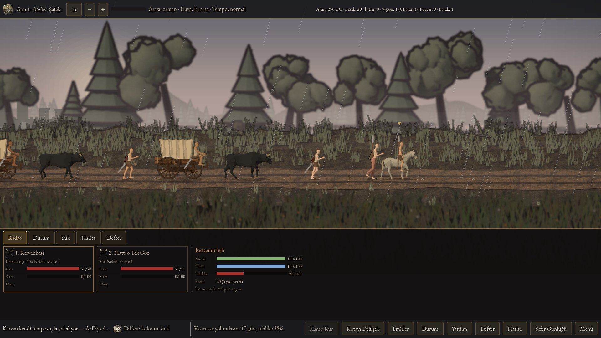

**Kadro sekmesi** (varsayılan):
- Solda kişi kartları: sınıf amblemi, açlık çetelesi, can ve stres çubuğu (sayısıyla), hâli (dinç, yaralı...), görevi.
- Sağda "Kervanın hâli": moral, takat, tehlike çubukları, kaç gün yetecek erzak, isimsiz tayfa sayısı.

Diğer dört sekme (yukarıdan aşağı: Durum, Yük, Harita, Defter):

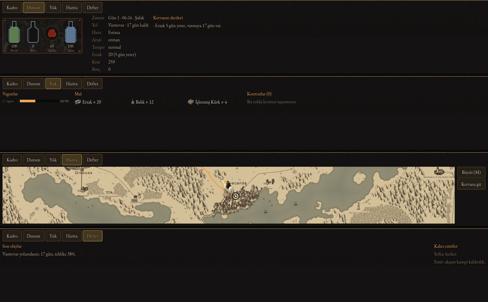

- **Durum:** dört gösterge, sayılar (zaman, yol, hava, arazi, tempo, erzak, kese, borç), "kervanın dertleri" kelimeyle
  (sayı değil). Örnekte: "Erzak 5 gün yeter, varmaya 17 gün var."
- **Yük:** vagonların doluluğu, mallar ikonlarıyla, taşınan kontratlar.
- **Harita:** küçük harita, kervan yolun üstünde. "Büyüt (M)" açılır haritayı açar, "Kervana git" ortalar.
- **Defter:** son olaylar ve kalıcı emirler (sofra, akşam kampı).

**Bakman gerekenler:**
- [ ] Panelin yüksekliği ve sahnenin kırpılması hoşuna gidiyor mu? (İki sabit: `SKY_CROP_SHARE` 0,19,
  `CONTROL_PANEL_SHARE` 0,27.)
- [ ] Kadro kartlarında eksik bir bilgi var mı?
- [ ] Panel karar vermiyor, yalnızca okuyor; kararlar yine emir paneli, olay kartı ve sofrada. Bu ayrım uygun mu?

## 2. Senin bildirdiğin üç hata

### Dağ zirvelerindeki kesik

Sebep: dağ biyomunun uzak katmanı render karesinin üstünü aşıyordu. Eskiden o kesik üst şeridin arkasında kalıyordu;
sahne yukarı kayınca görünür oldu. Uzak katman daha yüksek bir kareyle yeniden render edildi. Diğer dört biyomda bu sorun
yoktu (ölçüldü).

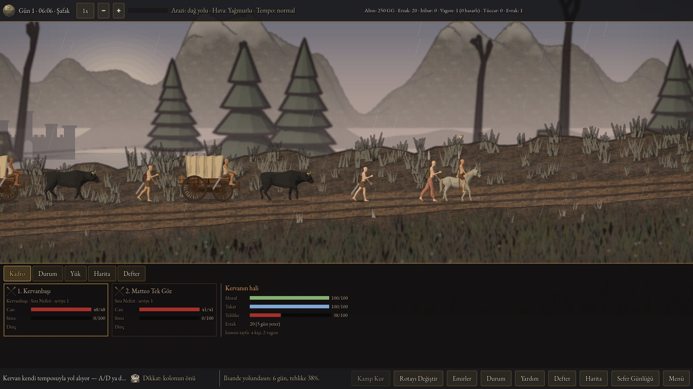

### Vagon sürücüsü

Koltukta düz bir silüet (bir daire ve bir dörtgen) çiziliyordu; gerçek figür yalnızca kampta koltuktan iniyordu. Artık
yolda da yeni gövde oturuyor (koltuktan inme klibinin ilk karesi). Kampta inip ateşe yürüyor, dönüşte yine oturuyor.

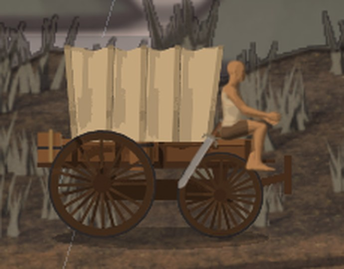

### Haritadaki atlının gölgesi

Gölge en öndeki toynağın altına ortalanıyordu. Haritanın eğik bakışında arka toynaklar daha yukarıda göründüğü için
arka ayaklar havada kalıyordu. Gölge ve harita üzerindeki bağlantı noktası artık dört toynağın ortasında. Sekiz yön de
yeniden üretildi.

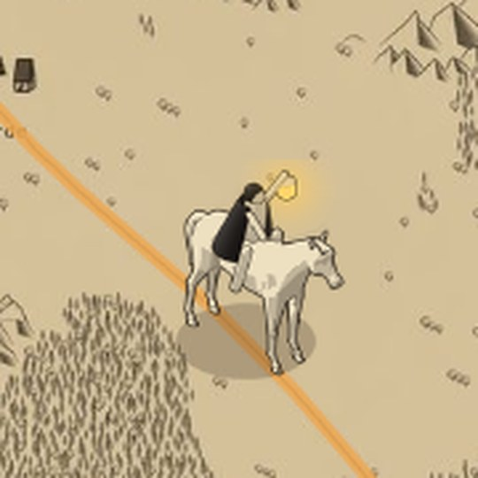

**Bakman gerekenler:**
- [ ] Çapraz yönlerde (KD, GD, GB, KB) gölge biraz büyük ve yuvarlak; küçültmemi ister misin?
- [ ] Sürücünün belinde tayfanın kılıcı asılı. Sürücüye dizgin tutturmak yeni bir klip ister (3D render).

## 3. Harita

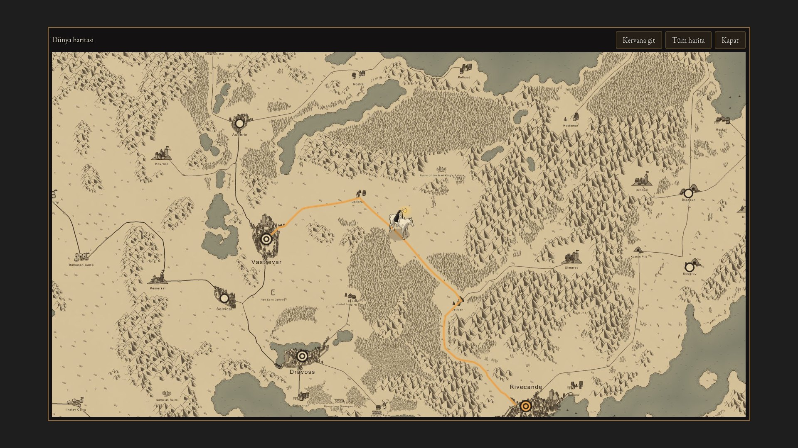

Açılır harita: zaman durur, kervan ortada ve gittiği yöne bakıyor, hedef turuncu. Esc, düğme ya da arka plana tıklama
kapatır.

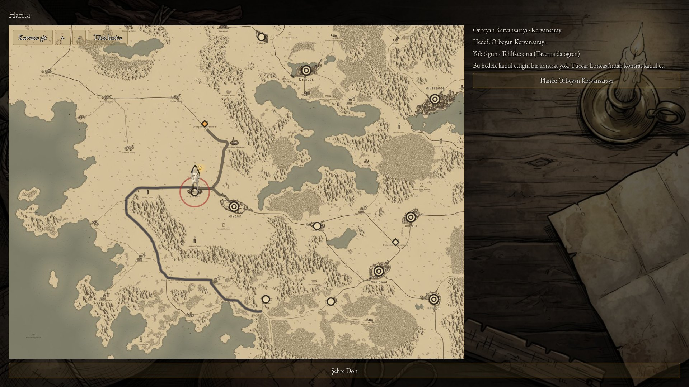

Şehirdeki harita ekranında yerleşimin türü işaretinden okunur: şehir çift halka, kasaba tek halka, kervansaray
baklava. Yollar durumuna göre renkli. Kırmızı halka, kervanın büyüklüğüne göre daralan "buradasın" halkası.

**Bakman gerekenler:**
- [ ] Haritada yer adları haritanın kendi resminde yazılı. Üstüne gelince ipucu çıkıyor. Ek etiket ister misin?

## 4. Yerleşim menüleri (P17)

Her yerleşimin kendi resmi var. Resim, `tools/ui_scenes/settlement_towns.py` ile beş girdiden üretiliyor; elle
yerleştirme yok:
- **Kültür:** mimari, ışık ve renk.
- **Enlem:** kuzeyde kar ve soğuk ışık.
- **Tür:**
  - şehir: sur, kapı, lonca, kale;
  - kasaba: ahşap çit, lonca ve avlu yok;
  - kervansaray: dört yanı duvarlı avlu, kilise yok.
- **Haritadaki alt tür:** liman, özgür şehir, maden, bataklık, nehir, pazar.
- **Mallar:** fıçı, saman, değirmen, çuval, tente.

Soldaki levhalar türe göre: şehirde altı mekân, kasabada dört (pazar, taverna, kilise, terzi), kervansarayda üç (avlu,
pazar, taverna).

Kültürlerin dili, senin benzetmelerine ve coğrafyaya göre:

| Kültür | Görünüş |
|---|---|
| Vadi (Tyrell gibi) | Altın ışık, yeşil tepe, açık taş |
| Kuzey imparatorluğu (Nilfgaard gibi) | Koyu taş, kara kuleler, mor gece, kuzeyde kar |
| Sınır halkları | Ahşap çit, ahşap kuleler |
| Dağ ve madenler | Karlı sırt, kaya, çam |
| Güney (Essos gibi) | Turuncu ufuk, kum rengi zemin, düz damlar, tenteler |
| Ahit (Orvahel) | Soluk taş, dört kuleli büyük tapınak |
| Göçebe | Çadırlar, ateş |

Her türden birer tam boy örnek:

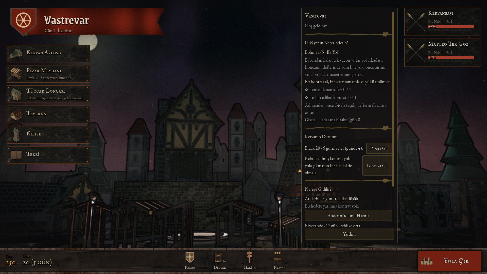

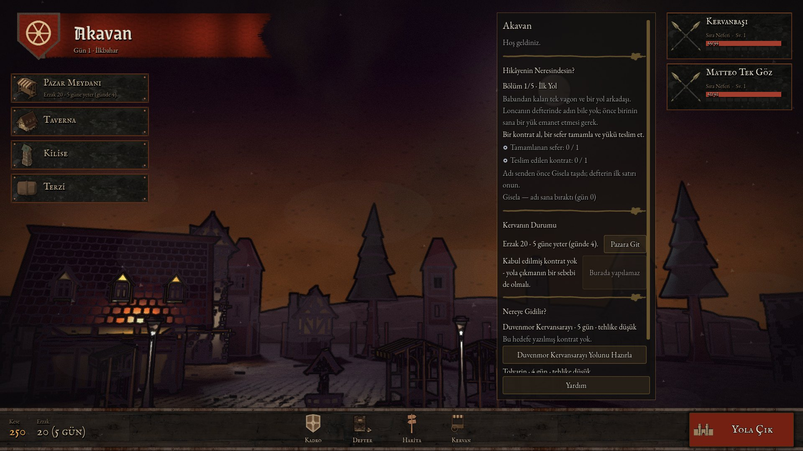

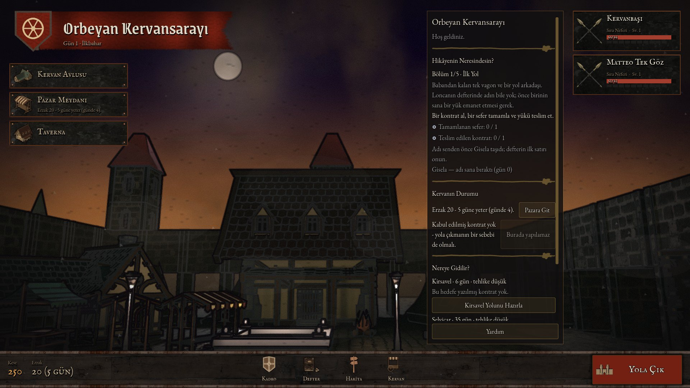

Hepsi bir arada:

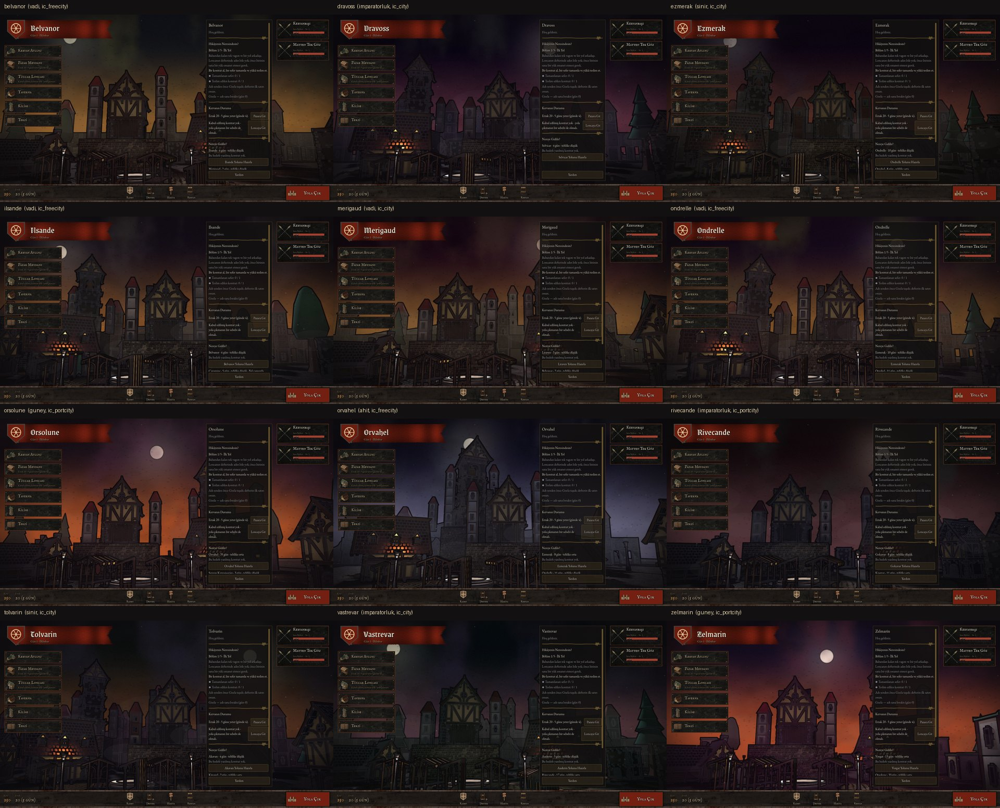

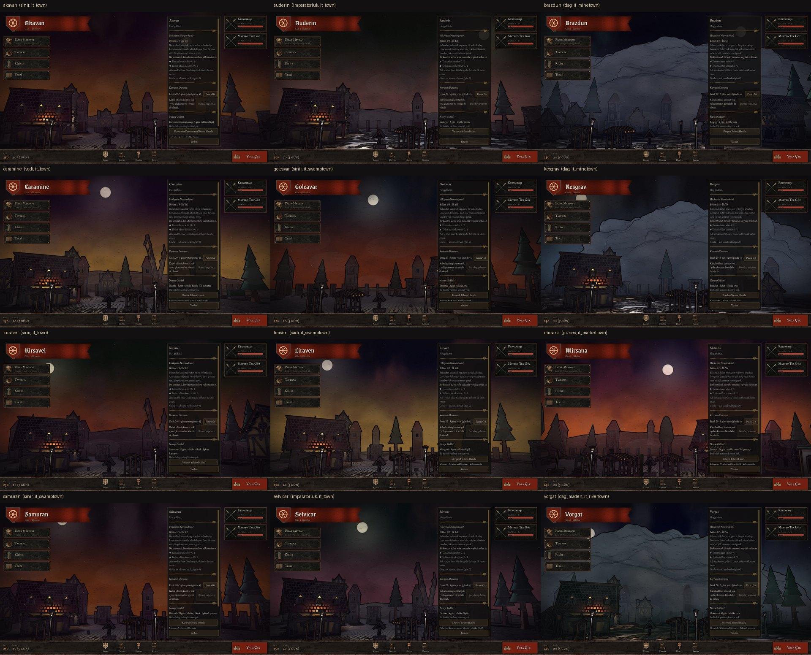

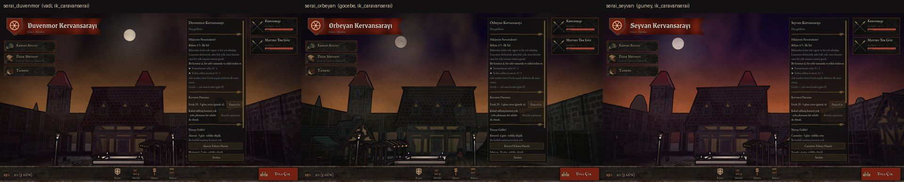

Stil rehberi `wayborne/docs/ui/STIL_REHBERI.md` dosyasında. Onayladığın cümleyle açılıyor; renk kodlarını, "kırmızı
yalnızca kan, kayıp ve ana eylem için" ve "kehribar yalnızca ışık için" kurallarını, üç ton ve tek sıcak ışık kuralını
içeriyor.

**Bakman gerekenler (en çok burada görüşün lazım):**
- [ ] Şehirler birbirine fazla benziyor mu? İskelet ortak (levhalar ve brifing aynı yerde dursun diye): meydan önde,
  lonca ortada, han sağda. Fark renkte, ışıkta, surda ve arka plandaki kalede.
- [ ] Kasabalar seyrek: meydan boş, evlerin çoğu brifing sütununun arkasında kalıyor. Ev sayısını artırıp meydana
  yaklaştırabilirim.
- [ ] Liman şehirlerinde deniz yalnızca açık bir ufuk olarak okunuyor; gerçek su yüzeyi yok.
- [ ] Hepsi gece. İstersen kültüre göre saat de değişebilir (güneyde alacakaranlık, kuzeyde gece gibi).
- [ ] Brifing sütunu resmin sağ üçte birini örtüyor. Kamerayı 2 m sağa aldım; yine de sağdaki yapılar az görünüyor.

## 5. Yolun arazisi haritadan (N28, commit `2c8be40`)

Senin onayınla eklendi. Yol ekranındaki arazi eskiden yalnızca yolun adından tohumlanıyordu; vadideki Belvanor-İlsande
yolu dağ yolu çıkıyordu. Artık her yolun biyomları ve durakları haritanın gerçek güzergâhından ölçülüyor:

- **Biyom** (öncelik sırasıyla):
  - dağlık alan ya da dağ halklarının bölgesi → dağ;
  - bataklık kasabasının (Liraven, Samuran, Golcavar) çevresi → bataklık;
  - göl ya da deniz kıyısı → göl;
  - orman içi ve kıyısı → orman;
  - kalanı, açık arazi → bozkır.
- **Parça:** en az 1,2 gün.
- **Durak:**
  - dağa girişte geçit, suya girişte köprü;
  - yoksa yoldaki harita noktası: kule ya da harabe karakol, manastır ya da dikili taş sunak, maden, köy ya da yurt
    mezra;
  - durak aralığı en az üç gün.
- **Ters yön:** Aynı yolda öbür yönden gelen kervan diziyi ters sırada görür.
- **Testler:** Haritanın 41 yolu iki yönden sınanıyor: kaplama, ayna, coğrafya ve erzak vaadi.

Haritadaki 41 yolda: 58 bozkır, 22 dağ, 20 orman, 15 göl, 10 bataklık parçası.

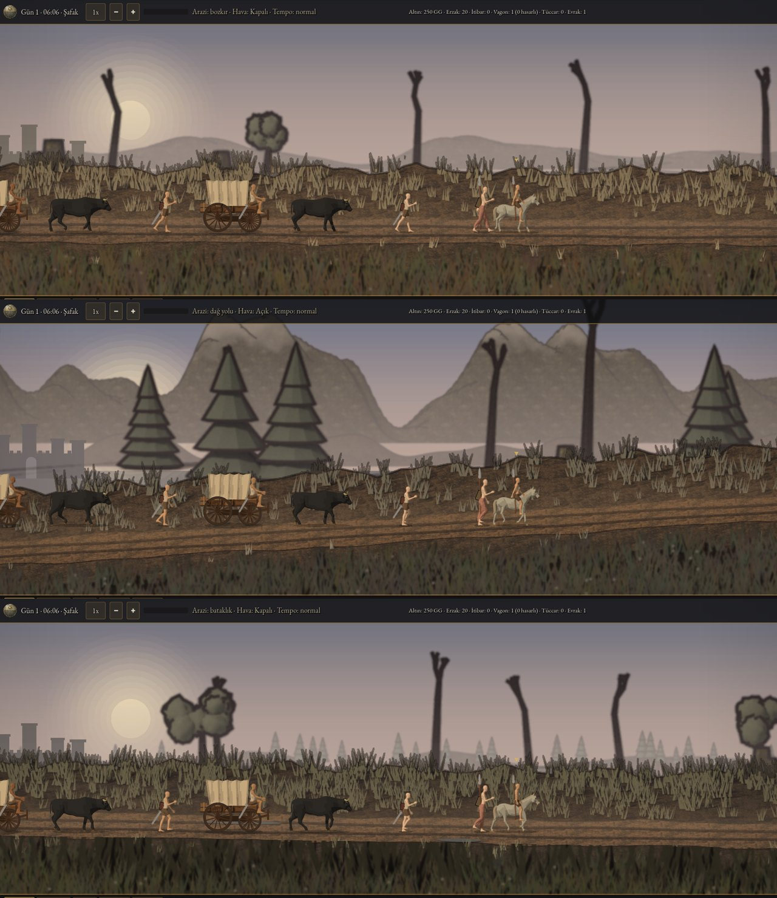

Yukarıdan aşağı: Belvanor → İlsande (vadi, bozkır), Brazdun → Kesgrav (dağ), Ezmerak → Golcavar (bataklık).

**Bakman gerekenler:**
- [ ] Vadinin açık tarım arazisi "bozkır" görseliyle çiziliyor. Vadiye özgü yeşil bir çayır biyomu ister misin?
  (Yeni biyom = Blender'da dört katmanlı yeni şerit render'ı.)
- [ ] Göçebe bozkırında yollar birkaç günde bir yurtta (mezra) duruyor; sık gelirse aralığı açabilirim.

## 6. Kamp sırası (önceki turdan, değişmedi)

Koltuktan iniş, ateşe yürüyüş, ateşin ilk varanla tutuşması, dönüş ve biniş:

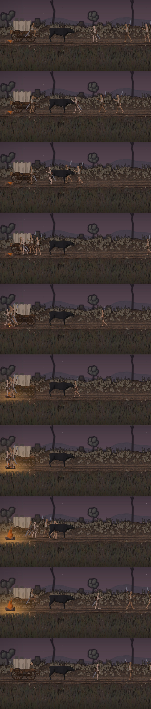

## 7. Ölçümler

- **Denge** (`wayborne/docs/design_notes/denge_yeni_dunya.md`):
  - Kontrat günlük ücreti 8'den 14 GG'ye çıktı. Uzun yollarda eski ücret erzakı karşılamıyordu.
  - Uzak başlangıç yeri kervanı batırıyordu. Başlangıç adayları artık ilk yolu 10 günü geçmeyen yerler.
  - 40 sefer yaklaşık 550 gün sürüyor. Final yaklaşık 20. seferde, 380. günde kapanıyor (eskiden 12-16. seferde).
- **Gerçek zamanda yol süresi:**

  | Yol | Gün | 1x hızda süre |
  |---|---|---|
  | Ortanca | 8 | ~6 dakika |
  | En uzun | 38 | ~28 dakika |

## 8. Açık kalanlar ve senin kararını bekleyenler

**Kısmen kalan iş:**
- **N23 Eski HUD parçaları:** Göstergeler panele taşındı. Tab ile açılan ayrıntılı "Kervan Durumu" katmanı ve üst
  şeritteki sayı satırı duruyor. Panelden fazlasını gösteriyorlar (defter, kontrat ayrıntısı). Kaldırayım mı,
  birleştireyim mi?
- **Kariyer simülasyonu:** 8 kervandan 1'i 40 seferde ilk bölümü kapatamıyor. Genişleme politikası batıyor; bir dünya
  hatası değil, izleniyor.

**Senin kararını bekleyen sorular:**
- Oyunda 5 kültür var, haritada 8. Eski imparatorluk, sınır halkları ve Ahit oynanabilir kültür olsun mu? Şimdilik
  başlangıç yeri en yakın bölgeden seçiliyor.
- `AI_DISCLOSURE.md`'de iki müzik parçasının kaynağı eksik; senin doldurman gerek.
- P00 listesindeki açık sorular duruyor (`TODO/00_BASLA_BURADAN.md`).

**Doğrulanmayanlar:**
- GitHub CI (`tests.yml`, `screenshots.yml`, LFS'li checkout) GitHub'da hiç çalışmadı; dal push edilmedi.
- `docs/Wayborne-Codex.pdf` eski. Yeni dünyayı ve yeni olayları içermiyor.

## Dosyalar

- Plan ve kararlar: `TODO/gorevler/14_yeni_dunya.md`. Görev durumları N1-N28 işlendi.
- Devir notu: `TODO/devir/DEVIR_NOTU.md`. Devam noktası: `TODO/devir/DEVAM_BURADAN.md`.
- Görüntüler: `TODO/kontrol_goruntuleri/`. Yeniden çekmek için:

  ```
  godot --path . --resolution 1920x1080 --script res://tests/screenshot_settlements.gd
  godot --path . --resolution 1920x1080 --script res://tests/screenshot_journey_screen.gd -- 1920 1080 belvanor ilsande
  godot --path . --resolution 1920x1080 --script res://tests/screenshot_map_popup.gd
  ```
