# Wayborne — İkinci Art Turu Referansları (Menüler ve Arka Planlar)

> Hazırlanma tarihi: 2026-10-17 · Kapsam: menüler, şehir/mekân ekranları, karakter ve savaş ekranları, yol/ortam arka planları

---

## Giriş

### Amaç

Bu belge, Wayborne'un **ikinci art turu** için görsel referans kitaplığıdır. İlk turda ekranlar işlevsel hâle geldi; ikinci turun hedefi menülerin ve arka planların **tek bir mürekkep-ve-parşömen görsel dilinde** birleşmesi, atmosferin (karanlık, yorgun, tehlikeli yol hissi) güçlenmesi ve bilgi yoğun ekranların (karakter, savaş, pazar) okunur kalmasıdır.

Referanslar, kullanıcının topladığı ve tür olarak bize en yakın kabul edilen bir oyundan (aşağıda **"referans oyun"**) alınmış ekran görüntüleridir. Amaç kopyalamak değil; kompozisyon, ışık, çerçeveleme ve UI yoğunluğu konusundaki **ilkeleri** çıkarıp Wayborne'un kendi dünyasına (kervan, yol, şehir kapısı, gece kampı) uyarlamaktır.

### Kaynaklar

Kaynak Word belgeleri değiştirilmeden `../referanslar/art_ikinci_tur/kaynak_belgeler/` altına kopyalandı; tüm görseller orijinal pikselleriyle (yeniden sıkıştırma olmadan) belge sırasına göre çıkarıldı.

| # | Kaynak belge | Görsel klasörü | Görsel sayısı |
|---|---|---|---|
| 1 | `arka planlar belgesi (depoda yok)` | `gorseller/arkaplanlar/` | 29 |
| 2 | `karakter ve savaş ekranları belgesi (depoda yok)` | `gorseller/karakter_ve_savas/` | 5 |
| 3 | `kasaba ekranları belgesi (depoda yok)` | `gorseller/kasaba/` | 12 |
| | **Toplam** | | **46** |

### Nasıl okunmalı

- Her görsel kendi alt başlığında, belge içindeki sırasıyla numaralıdır: **A-xx** (arka planlar), **K-xx** (karakter ve savaş), **T-xx** (kasaba). İş listesi bu numaralara atıf yapar.
- **"Kullanıcı notu"** kutuları Word belgesindeki metnin birebir alıntısıdır (yazım olduğu gibi bırakıldı; arka plan belgesindeki notlar Türkçe karakter kullanmadan yazılmıştır).
- **Açıklama** yalnızca görüntüde görülebilen şeyleri anlatır; görünmeyen mekanikler varsayılmamıştır.
- **"Wayborne'a uyarlanacak olan"** maddeleri doğrudan art/UI işine dönüşebilecek somut çıkarımlardır.
- Görsel bağlantıları bu belgenin bulunduğu `belgeler/` klasörüne göre görelidir.

---

## 1. Arka planlar

Kaynak: `arka planlar belgesi (depoda yok)`. Belge başlığı ve giriş notu:

> **Kullanıcı notu (belge başlığı):** "referans oyun Arka Planlari ve Sahneleri"
>
> "Bu dosyada referans oyun oyununa ait ana bolgelerin arka plan tasarimlari, yer aldiklari sahneler ve gorsel aciklamalari listelenmistir."

Bölümdeki tüm görseller yatay, **geniş en-boy oranlı (yaklaşık 2.3:1 ile 2.7:1 arası) "sahne şeritleri"** ya da bunlardan alınmış kare kesitlerdir. Ortak teknik: kalın siyah kontur, el çizimi tarama (hatching), düz renk lekeleri, kenarlara doğru siyaha akan vinyet ve tek bir baskın sıcak/soğuk ışık kaynağı.

### 1.1 Harabeler (The Ruins)

> **Kullanıcı notu:** "1. The Ruins (Harabeler) Arka Plani"
>
> "Aciklama ve Sahneler: Eski kaleler, tas sutunlar, Gotik pencereler ve antik kutuphane raflariyla bezeli kapali alan yapilaridir. Gri ve siyah tonlar hakimdir."
>
> "[ 1. The Ruins (Harabeler) Arka Plani Gorsel Yer Tutucu ](Zindan arama ve savas esnasinda arkada dinamik olarak akan çevre tasarimi)"

#### A-01 — Şapel sunağı

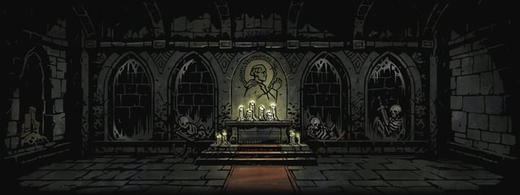

- **Ne:** Kapalı mekân "oda" arka planı (640×240), simetrik şapel/kripta.
- **Kompozisyon:** Tam simetri; ortada basamaklı sunak ve üstünde haleli aziz figürlü madalyon; iki yanda dörder gotik sivri kemerli niş, nişlerde iskeletler. Zeminde merkeze inen kırmızı halı yolu göz çizgisini ortaya taşıyor. Yan duvarlar perspektifle içe kapanıyor.
- **Palet / ışık:** Yeşilimsi soğuk gri taş; tek sıcak kaynak sunaktaki mumlar (sarı). Kırmızı halı tek doygun renk vurgusu. Üst ve alt kenarlar siyaha gömülü.
- **Çizgi / doku:** Kalın kontur, taş blokların kenarlarında kısa tarama çizgileri; düz, gradyansız boyama.
- **Atmosfer:** Kutsal ama terk edilmiş, sessiz.
- **Wayborne'a uyarlanacak olan:**
  - Kilise mekânı (`church.tscn`) arka planı için: simetrik eksen + ortada tek sıcak ışık + zeminde ortaya çeken yol/halı.
  - Doygun rengi sahne başına tek bir öğeye ayır (burada halı); geri kalan desatüre kalsın.
  - Üst/alt %15'lik bandı siyaha boğ; UI başlık ve alt bar bu karanlık bantların üstüne oturur.

#### A-02 — Kütüphane

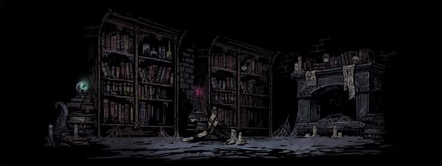

- **Ne:** Kapalı mekân arka planı (736×276): yüksek kitap rafları, sağda şömine.
- **Kompozisyon:** Asimetrik; iki büyük raf merkezde, sağda şömine ve üzerinde mum/kafatası, solda kitap yığını ve yeşil parlayan küre. Zeminde yatan bir ceset (iskelet). Arka plan tamamen siyah boşluk — duvar çizilmemiş, nesneler karanlıkta "yüzüyor".
- **Palet / ışık:** Kahve-gri, çok koyu; iki küçük **renkli büyü ışığı** (yeşil-camgöbeği küre, macenta alev). Ana aydınlatma yok, nesneler kendi konturlarıyla okunuyor.
- **Atmosfer:** Unutulmuş bilgi, kasvetli.
- **Wayborne'a uyarlanacak olan:**
  - Waybook/defter (ledger) ekranının arka planı için: raf, kitap yığını, mum — ama arka duvarı çizmeden siyah boşluğa bırakarak UI paneline yer aç.
  - Küçük, renkli "büyü noktası" ışıkları (1–2 adet) siyah sahnede göz çapası işi görür; menülerde odak noktası olarak kullan.

#### A-03 — Gotik duvar (kare kesit)

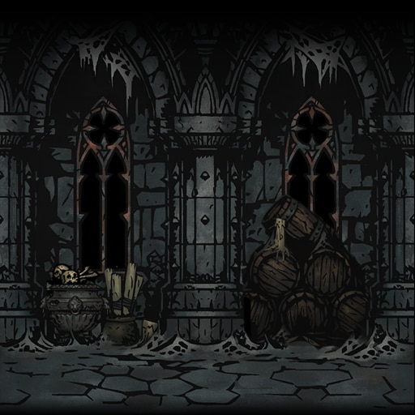

- **Ne:** 512×512 kare kesit; tekrarlanabilir koridor duvarı parçasına benziyor.
- **Kompozisyon:** Arka duvarda iki sivri gotik pencere (kırmızımsı çerçeve), üstte örümcek ağı/sarkıntılar; önde solda kafatası dolu kazan ve süpürge/odun demeti, sağda üst üste fıçılar. Zemin altıgen-düzensiz taş döşeme.
- **Palet / ışık:** Mavi-gri taş, pencere çerçevelerinde koyu kırmızı ince vurgu; ışık düz, gölgeler tarama ile.
- **Atmosfer:** Kullanılmış, depolanmış, terk edilmiş.
- **Wayborne'a uyarlanacak olan:**
  - Yol arka planlarında (`ui/road/<biyom>/`) "orta katman" için modüler, yan yana eklenebilen parçalar üret: aynı duvar ritmi + değişen ön plan propları (fıçı, sandık, kazan).
  - Zemin dokusu ayrı bir şerit olsun ki farklı orta katmanlarla tekrar kullanılabilsin.

#### A-04 — Kan çeşmesi salonu

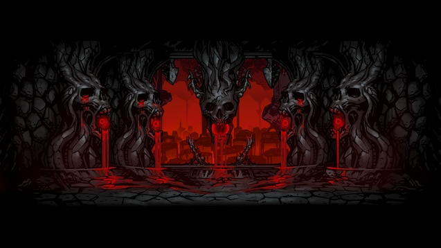

- **Ne:** Özel/doruk noktası odası (637×358, letterbox'lı).
- **Kompozisyon:** Simetrik; beş dev kafatası-heykel sütunu, ağızlarından kan akan oluklar; ortadaki en büyük. Arkada kırmızı gökyüzü önünde şehir siluetleri.
- **Palet / ışık:** Siyah-gri + **yoğun kan kırmızısı** arka ışık ve gözlerde parlayan kırmızı noktalar. Tamamen kırmızı monokrom vurgu.
- **Atmosfer:** Tehdit, final/boss hissi.
- **Wayborne'a uyarlanacak olan:**
  - "Kritik durum" ekranları (kervan çöküşü, ölüm, yenilgi) için palet kuralı: normalde yasaklanan doygun kırmızı yalnızca bu anlarda tüm sahneye yayılır.
  - Arka plandaki kırmızı ışığın önünde siluet şehir — CityFront'un "tehlike" varyantı için doğrudan fikir (bkz. A-28).

#### A-05 — Yıkık koridor

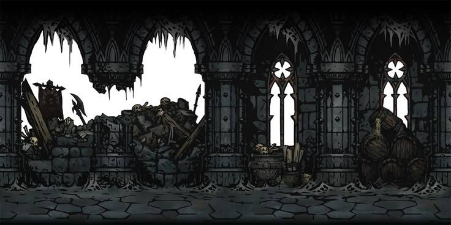

- **Ne:** Geniş koridor şeridi (736×368). Solda iki büyük duvar yarığı ve pencereler **saf beyaz** — muhtemelen arkadaki paralaks katmanı için bırakılmış boş/şeffaf alanlar.
- **Kompozisyon:** Sol yarıda yıkılmış duvar, moloz yığını, sancak, balta, mızrak, kafatasları; sağ yarı A-03'teki duvar ritmiyle aynı (kazan + fıçılar). Bu, aynı modüler setin farklı varyasyonu olduğunu gösteriyor.
- **Palet / ışık:** Gri-mavi taş, düz ışık.
- **Wayborne'a uyarlanacak olan:**
  - Katmanlı (paralaks) yol arka planlarında ön katmanda gerçek "delikler" bırak; arkadaki uzak katman (gökyüzü/vadi) bu deliklerden görünsün. Mevcut `far/mid/ground/fore` yapısıyla birebir uyumlu.
  - Aynı duvar modülünün "sağlam" ve "yıkık" iki versiyonu, tekrar hissini kırmak için ucuz bir yöntem.

#### A-06 — Mangal ve sunak salonu

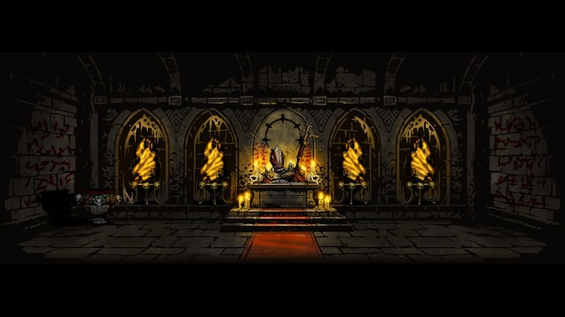

- **Ne:** A-01 ile aynı mimari iskelet, farklı durum (637×358).
- **Kompozisyon:** Ortada dikenli halkalı tahtta/sunakta figür; dört nişte yanan mangallar; yan duvarlarda kırmızı karalama/rün yazılar; solda kazan.
- **Palet / ışık:** A-01'in soğuk grisine karşın **sıcak sarı-turuncu** ateş ışığı; kırmızı duvar yazıları.
- **Wayborne'a uyarlanacak olan:**
  - **Aynı sahnenin durum varyantları** ilkesi: tek çizim, farklı ışık/props katmanı ile "sakin" ve "tehlikeli" versiyon (A-01 → A-06). Mekân ve şehir arka planlarında uygula.
  - Duvara karalanmış yazı/işaret katmanı ayrı bir overlay olarak hazırlanabilir (bizde `grime_overlay`, `ink_blot` ailesine eklenebilir).

#### A-07 — Mağara gölü

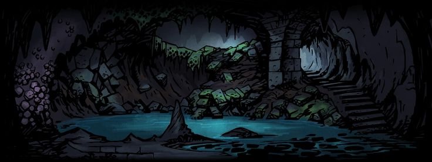

- **Ne:** Doğal mağara (736×276); belgede Harabeler altında yer alıyor.
- **Kompozisyon:** Ortada turkuaz göl, ortasında sivri kaya; arkada yosunlu kaya yığını; sağda yıkık taş kule ve yukarı çıkan merdiven; sağ üstte mavi ışıklı açıklık.
- **Palet / ışık:** Mor-gri kaya, yosun yeşili, **parlak turkuaz su** — suyun kendisi ışık kaynağı gibi.
- **Wayborne'a uyarlanacak olan:**
  - Göl biyomu (`ui/road/lake/`) için: suyu ışık kaynağı gibi boya, çevreyi koyu bırak.
  - Sahne kenarında "çıkış" ipucu (merdiven + ışıklı açıklık) yol ilerleme hissi verir.

#### A-08 — Batık tapınak mağarası

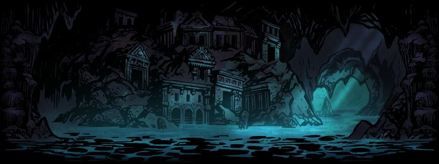

- **Ne:** Mağara içinde, kaya kütlesine gömülmüş klasik sütunlu yapılar (736×276).
- **Kompozisyon:** Merkez-solda üst üste binen tapınak cepheleri; sağda ışık sızan mağara ağzı; önde koyu dalgalı su.
- **Palet / ışık:** Neredeyse monokrom koyu camgöbeği; sağdan gelen ışık huzmesi.
- **Wayborne'a uyarlanacak olan:**
  - Tek renk tonuna indirgenmiş (monokrom + tek ton) arka planlar, üzerinde UI çok yoğun olan ekranlar için ideal.
  - Mimariyi doğaya gömerek "eski medeniyet" hissi — yol olayları (ör. kalıntı/geçit olay kartları) için kullanılabilir.

### 1.2 Ormanlık alan (The Weald)

> **Kullanıcı notu:** "2. The Weald (Ormanlik Alan) Arka Plani"
>
> "Aciklama ve Sahneler: Curumus agac kokleri, mantarlar, tekinsiz cadi kulubeleri ve mezar taslariyla kapli tekinsiz orman manzaralaridir. Kahverengi ve turuncu tonlar agirliktedir."
>
> "[ 2. The Weald (Ormanlik Alan) Arka Plani Gorsel Yer Tutucu ](Zindan arama ve savas esnasinda arkada dinamik olarak akan çevre tasarimi)"

#### A-09 — Taş kemer ve mezar

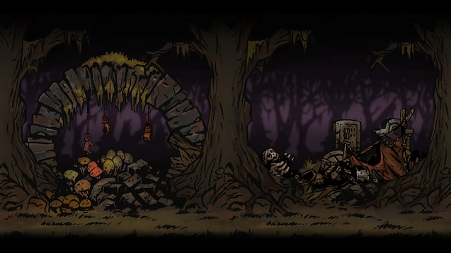

- **Ne:** Orman koridoru (637×358).
- **Kompozisyon:** Solda yosunlu yuvarlak taş kemer, kemerden sarkan bez bebek/kukla figürleri, dibinde turuncu mantar yığını; ortada ve sağda kalın ağaç gövdeleri; sağda devrilmiş araba enkazı, iskelet ve mezar taşı.
- **Palet / ışık:** Ön plan kahve-zeytin; **arka plan mor tonlu ağaç siluetleri** — derinlik renk sıcaklığıyla veriliyor (sıcak ön, soğuk/mor arka).
- **Atmosfer:** Tekinsiz, terk edilmiş yol kenarı.
- **Wayborne'a uyarlanacak olan:**
  - Orman yol arka planı (`ui/road/forest/`) için doğrudan referans: devrilmiş araba/kervan enkazı motifi bizim temamıza birebir uyuyor.
  - Uzak katmanı tek tonlu mor/soğuk siluet olarak boya; orta ve ön katman sıcak kahve.

#### A-10 — Kemer ve turuncu arka ışık (geniş)

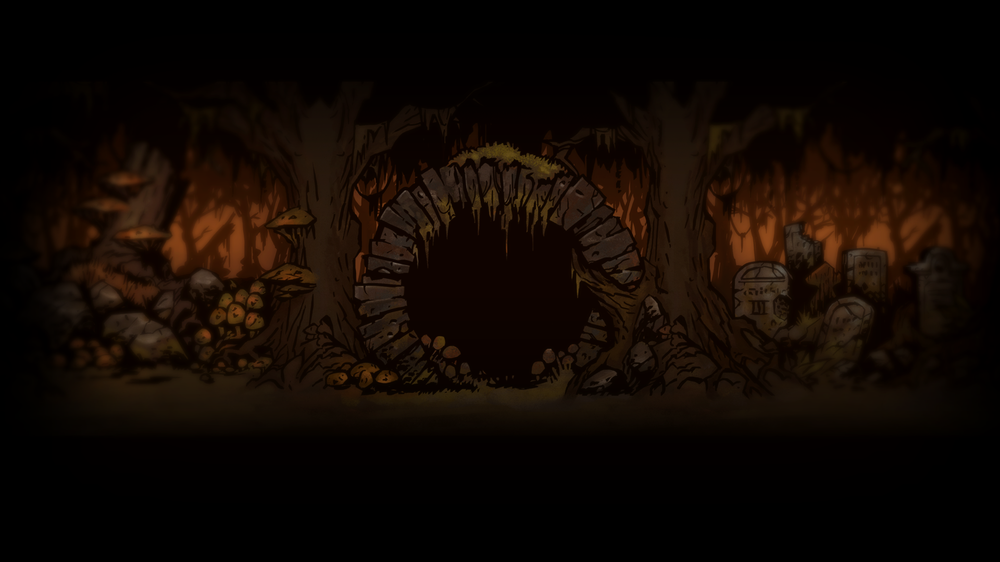

- **Ne:** 1920×1080 tam ekran görüntü; sahne şeridi ekranın ortasında, üst ve alt **kalın siyah letterbox** ile.
- **Kompozisyon:** Merkezde taş kemer, içi tamamen siyah (geçit); solda mantarlı kütük ve taşlar; sağda yazılı mezar taşları (bir taşta "III" rakamı).
- **Palet / ışık:** Arka katman **turuncu** parlıyor, ağaçlar önünde siyah siluet; kenarlar güçlü vinyetle karanlık.
- **Wayborne'a uyarlanacak olan:**
  - Tam ekran sahnelerde sahne şeridi ekranın yalnız ortasındaki ~%55'lik bandı kaplar; üst/alt bantlar UI için ayrılır. Wayborne'un 16:9 yol ekranında da aynı bant yapısı kullanılabilir.
  - Arkadan aydınlatma (rim/back-light) + ön planda siluet: menü arka planlarında odak ve derinlik için en ucuz yöntem.

#### A-11 — Tabut ve dua eden heykel (kare kesit)

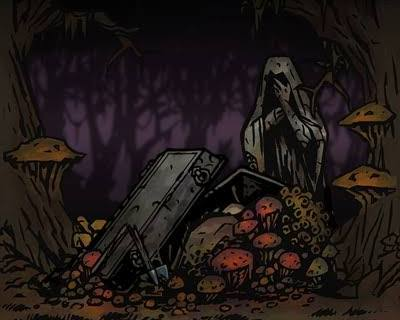

- **Ne:** 400×320 yakın kesit.
- **Kompozisyon:** Eğik duran açık tabut, arkasında dua eden pelerinli heykel, önde kırmızı benekli mantar kümeleri; iki yanda ağaçlardan çıkan raf mantarları.
- **Palet / ışık:** Mor arka plan, gri taş, kırmızı-turuncu mantarlar.
- **Wayborne'a uyarlanacak olan:**
  - Yol olay kartları (`e6*` serisi) için prop yakın planı ölçeği: tek ana nesne + 1 dikey öğe + ön plan doku.

#### A-12 — Kıvrık ağaç tüneli

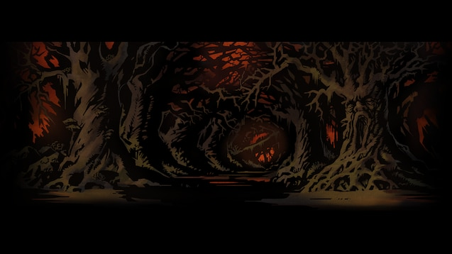

- **Ne:** Çok karanlık orman tüneli (637×358).
- **Kompozisyon:** Kökleri iç içe geçmiş ağaçlar bir tünel oluşturuyor; merkezde turuncu-kırmızı ışık çıkışı; sağdaki ağaç gövdesinde yüz benzeri form.
- **Palet / ışık:** Neredeyse siyah; yalnız boşluklardan sızan kırmızı-turuncu.
- **Wayborne'a uyarlanacak olan:**
  - Gece yolculuğu / tehlike yüksek yol durumları için arka plan değeri: genel parlaklık çok düşük, ışık yalnız ufuk noktasında.
  - Doğal formlarda gizli "yüz" — bilinçli, nadir kullanılan bir korku ipucu.

#### A-13 — Cadı kulübesi içi

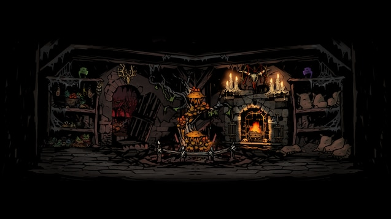

- **Ne:** İç mekân (637×358).
- **Kompozisyon:** Ortada kökten masa, üstünde mantar ve ateş; solda kırık kapı ve kırmızı ışıklı geçit; sağda taş şömine, üstünde mumlar ve boynuz/kafatası; iki yanda iksir şişeli raflar.
- **Palet / ışık:** Koyu kahve-gri; şömine ve mumlardan sıcak turuncu; şişelerde yeşil/mor küçük vurgular.
- **Wayborne'a uyarlanacak olan:**
  - Pazar/şifacı ya da kamp çadırı (`b9_tent`) iç mekânı için: yanlarda raf + ortada odak masası + bir sıcak ışık kaynağı düzeni.
  - Raflardaki küçük renkli şişeler, envanter ikonlarındaki renk kodlarıyla eşleşebilir.

#### A-14 — Anıt mezar

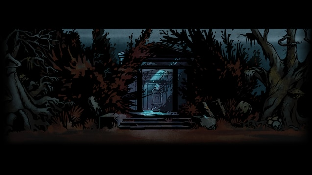

- **Ne:** Açık hava (637×358).
- **Kompozisyon:** Merkezde sütunlu küçük mozole, kapısından mavi ışık dökülüyor; basamaklar önde; iki yanda pas-kırmızısı yapraklı çalılar ve çarpık ağaçlar.
- **Palet / ışık:** Pas-kırmızı bitki örtüsü + soğuk mavi-camgöbeği ışık — **tamamlayıcı renk kontrastı**.
- **Wayborne'a uyarlanacak olan:**
  - Mezarlık/anma (düşen kervan üyeleri) ekranı için doğrudan ton referansı.
  - Sıcak çevre + soğuk tek ışık (veya tersi) kombinasyonunu biyom başına bir kez kullan.

#### A-15 — Parmaklıklı kaya kapısı

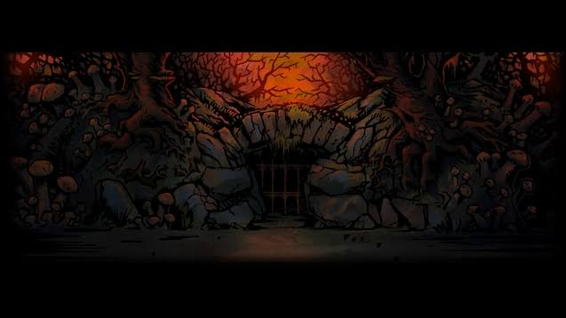

- **Ne:** Giriş/eşik sahnesi (637×358).
- **Kompozisyon:** Merkezde kaya kütlesine oyulmuş, demir parmaklıklı kemerli kapı; iki yanda mantar kaplı ağaçlar; üstte turuncu gökyüzü önünde dallar.
- **Palet / ışık:** Turuncu-kırmızı gökyüzü, gri kaya, siyah konturlar.
- **Wayborne'a uyarlanacak olan:**
  - Şehir kapısı / geçit (gate) sahneleri için "kapı ortada, kapalı, arkada sıcak gök" kompozisyonu.
  - Sahne girişlerinde (bölüm ya da biyom başlangıcı) tek odaklı merkezî eşik.

### 1.3 Yeraltı tünelleri (The Warrens)

> **Kullanıcı notu:** "3. The Warrens (Mezbahalar / Yeralti Tunelleri) Arka Plani"
>
> "Aciklama ve Sahneler: Domuz adamlarin yasadigi, et kancalari, zincirler ve yeralti lagim kanallariyla dolu sarimsi-yesil kirli atmosfere sahip yeralti tünelleridir."
>
> "[ 3. The Warrens (Mezbahalar / Yeralti Tunelleri) Arka Plani Gorsel Yer Tutucu ](Zindan arama ve savas esnasinda arkada dinamik olarak akan çevre tasarimi)"

#### A-16 — Yıkık kemer (kare kesit)

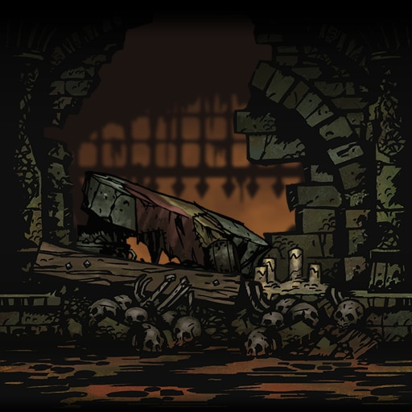

- **Ne:** 512×512 kare kesit.
- **Kompozisyon:** Yıkık tuğla kemerlerin arasında devrilmiş taş levha ve kırık kiriş; önde kafatası yığını ve mumlar; arkada turuncu ışık önünde parmaklık siluetleri.
- **Palet / ışık:** Zeytin-yeşili tuğla, kirli turuncu arka ışık, çamurlu kahve zemin.
- **Wayborne'a uyarlanacak olan:**
  - "Kirli" palet (zeytin + turuncu) bataklık biyomu (`ui/road/marsh/`) için uygun.
  - Arka planda silüet-desen (parmaklık) — derinliği detay çizmeden veren katman.

#### A-17 — Kemik yığını ve kasap kirişi

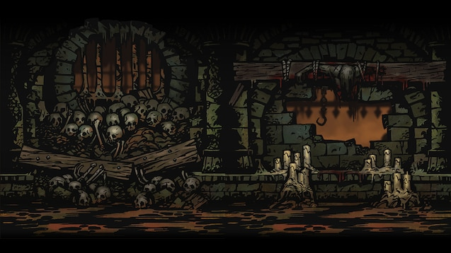

- **Ne:** Koridor şeridi (637×358).
- **Kompozisyon:** Solda parmaklıklı kemerin ardında kafatası yığını, önüne çakılmış tahtalar; sağda tahta kirişe asılmış karkas ve kancalar, kan damlaları; kırık duvardan turuncu ışık; zeminde eriyen mum kümeleri.
- **Palet / ışık:** Zeytin-yeşil taş, turuncu boşluklar, kırmızı damlalar.
- **Wayborne'a uyarlanacak olan:**
  - Erimiş mum kümesi motifi, ana menü/kamp ve defter ekranında küçük sıcak ışık kaynağı olarak tekrar kullanılabilir.
  - Ağır şiddet öğelerini (karkas, kan) bizim tonumuzda yalnız olay kartlarında ve dozunda tut.

#### A-18 — Kemik taht salonu

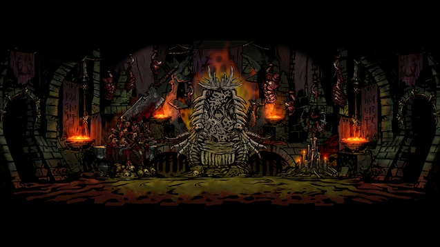

- **Ne:** Boss odası (637×358, letterbox'lı).
- **Kompozisyon:** Simetrik; merkezde kemiklerden yapılmış devasa taht ve üzerinde taçlı figür; iki yanda sancaklar, asılı etler, yanan mangallar; zeminde kafatasları ve mumlar.
- **Palet / ışık:** Turuncu ateş, sarımsı-yeşil zemin, siyah duvarlar.
- **Wayborne'a uyarlanacak olan:**
  - Özel karşılaşma (eşkıya lideri vb.) savaş arka planları için: simetri + merkezde tek büyük siluet + iki yanda ışık kaynakları.

### 1.4 Deniz mağaraları (The Cove)

> **Kullanıcı notu:** "4. The Cove (Koy / Deniz Magaralari) Arka Plani"
>
> "Aciklama ve Sahneler: Deniz canavarlarinin bulundugu, batik gemi enkazlari, mercanlar, parildayan yosunlar ve su alti magaralarindan olusan mavi-mor tonlarindaki cevre tasarimlaridir."
>
> "[ 4. The Cove (Koy / Deniz Magaralari) Arka Plani Gorsel Yer Tutucu ](Zindan arama ve savas esnasinda arkada dinamik olarak akan çevre tasarimi)"

#### A-19 — Tapınak kapısı (geniş)

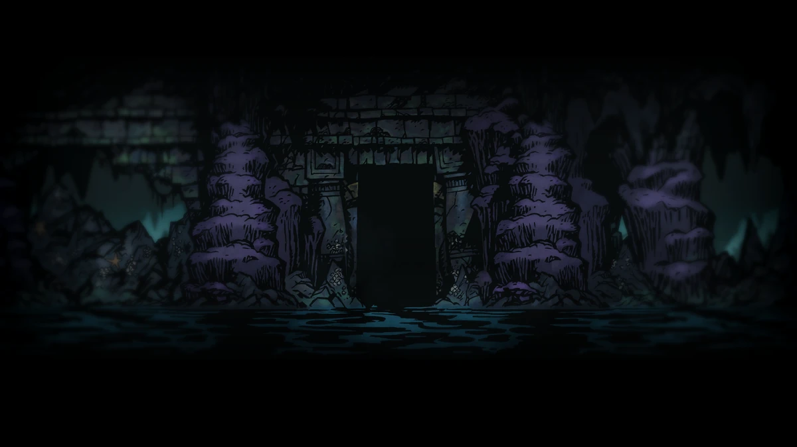

- **Ne:** 1200×675 tam ekran, güçlü vinyet ve letterbox.
- **Kompozisyon:** Merkezde dikdörtgen, içi tamamen siyah tapınak kapısı; iki yanda istiflenmiş mor mercan/kaya sütunları; önde camgöbeği su.
- **Palet / ışık:** Mor + camgöbeği; parlaklık çok düşük, merkez hafif aydınlık.
- **Wayborne'a uyarlanacak olan:**
  - Ana menü ya da yükleme ekranı için "merkezde siyah geçit" kompozisyonu: başlık/logoyu bu karanlık boşluğun üstüne yerleştir.

#### A-20 — Sarmal oymalı dikilitaşlar

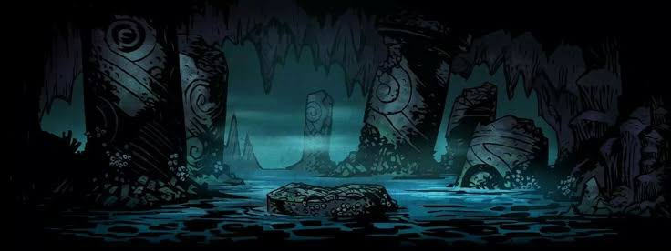

- **Ne:** 736×276 şerit.
- **Kompozisyon:** Sudan yükselen, sarmal desenli taş dikilitaşlar; ortada sudan çıkan yassı kaya; arkada sarkıtlar ve bir ışık huzmesi.
- **Palet / ışık:** Camgöbeği-lacivert monokrom; sis/ışık huzmesi.
- **Wayborne'a uyarlanacak olan:**
  - Sis ve ışık huzmesini ayrı yarı saydam katman yap (yavaş kayan overlay) — yol ve menü arka planlarında ucuz hareket.
  - Yüzeye oyulmuş tekrar eden bir motif (sarmal), bölgeye kimlik verir; Wayborne bölgeleri için her biyoma bir oyma/işaret motifi belirle.

#### A-21 — Putlar ve gemi enkazı

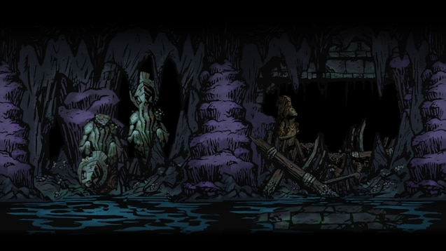

- **Ne:** 637×358 şerit.
- **Kompozisyon:** Solda midye kaplı iki taş put, sağda kırık gemi kaburgaları ve bir başka figür; aralarda mor mercan sütunları; önde su, sağ altta taş döşeme kalıntısı.
- **Palet / ışık:** Mor, yeşil-gri, camgöbeği su; düz ışık.
- **Wayborne'a uyarlanacak olan:**
  - Enkaz (gemi/araba kaburgaları) yol kenarı propu olarak: kervanın "önceden geçmiş ve kaybetmiş" kervanların kalıntılarını görmesi.

#### A-22 — Mercan ve rün taşı

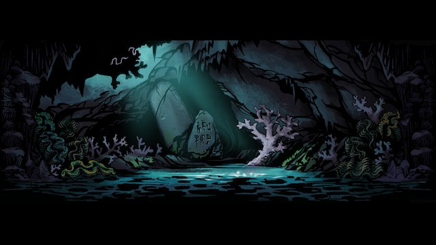

- **Ne:** 637×358, letterbox'lı.
- **Kompozisyon:** Mağara kubbesi altında ışık huzmesinin aydınlattığı yazılı dikili taş; sağda beyaz dallı mercan; iki yanda yosun ve istiridyeler; önde parlayan camgöbeği havuz.
- **Palet / ışık:** Lacivert-siyah; huzme ve su camgöbeği; mercan kırık beyaz.
- **Wayborne'a uyarlanacak olan:**
  - Huzme altındaki tek yazılı taş = "lore / kodeks" ekranının arka plan fikri.
  - En açık değeri (beyaz mercan) odak nesnesine ver; geri kalan her şey orta-koyu değerde.

#### A-23 — Sarmal dikilitaşlar (tekrar)

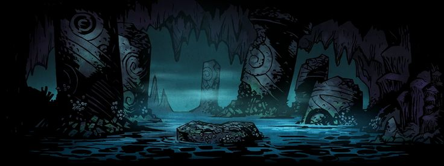

- **Not:** A-20 ile aynı görüntü (aynı boyut; yalnız sıkıştırma farkı var). Belgede iki kez eklenmiş; numaralandırmayı korumak için ayrı dosya olarak bırakıldı. Ek bir çıkarım yok.

#### A-24 — Mercan sütunlar ve oymalı taşlar

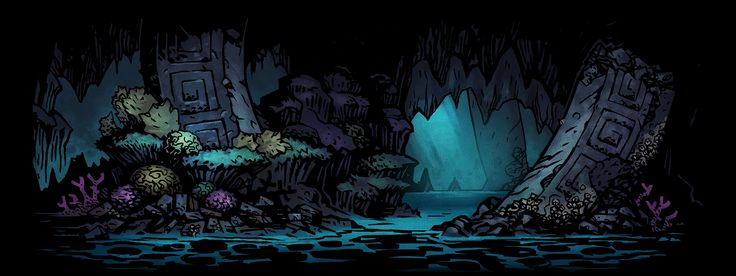

- **Ne:** 736×276 şerit.
- **Kompozisyon:** Solda ve sağda kare-spiral (meander benzeri) oymalı eğik taş bloklar; sol orta bölümde renkli mercan/sünger kümeleri; sağda ışık sızan mağara açıklığı; önde su.
- **Palet / ışık:** Lacivert-camgöbeği, mercanlarda bej-sarı ve mor küçük vurgular.
- **Wayborne'a uyarlanacak olan:**
  - Monokrom zemin üstünde 2–3 küçük renk kümesi: zengin ama okunur detay için oran.

### 1.5 Kasaba çevresi (Köy)

> **Kullanıcı notu:** "5. Köy (Kasaba Cevresi ve Atanin Kalesi) Arka Plani"
>
> "Aciklama ve Sahneler: Sefer aralarinda dinlendiginiz, uzerinde karanlik gokyuzunun yukseldigi, tepeye kurulmus yikik dokuk kasaba ve sato silüetlerini barindiran ana ekran arka planidir."
>
> "[ 5. Köy (Kasaba Cevresi ve Atanin Kalesi) Arka Plani Gorsel Yer Tutucu ](Zindan arama ve savas esnasinda arkada dinamik olarak akan çevre tasarimi)"

Bu beş görsel (A-25 – A-29) **aynı kompozisyonun farklı durum/zaman varyantlarıdır** (hepsi 640×327). Bina yerleşimi sabit; gökyüzü, ışık, bina hasarı ve figürler değişiyor. Wayborne'un CityFront ekranı için bu bölüm en doğrudan referanstır.

Ortak yerleşim: Ortada tepeye tırmanan merdivenli meydan ve sivri kuleli ana yapılar; arkada tepede kale siluet; solda kervan/araba ve yol tabelası, sol altta küçük köprü; sağda ateşi yanan atölye (demirhane) ve çarpık ağaçlar; meydan ortasında heykel; ön planda tezgâh-araba. Her bina ayrı tıklanabilir bir "mekân" olacak şekilde boşluklarla ayrılmış.

#### A-25 — Gece, yıldızlı

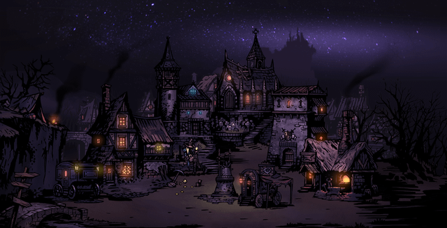

- **Palet / ışık:** Mor-lacivert yıldızlı gökyüzü; pencerelerde sıcak turuncu ve bir-iki camgöbeği ışık; bacalardan duman.
- **Atmosfer:** Sakin, yaşayan kasaba.
- **Wayborne'a uyarlanacak olan:**
  - Ana menü "gece kampı" ve CityFront gece varyantı için: soğuk mor gök + sıcak küçük pencereler. Pencere ışıkları ayrı katman olsun ki titreşim animasyonu verilebilsin.

#### A-26 — Alacakaranlık

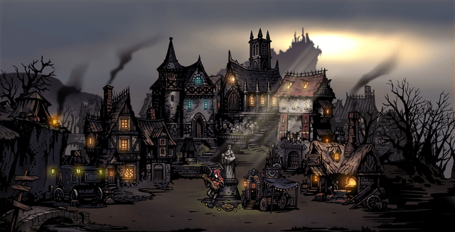

- **Palet / ışık:** Gri-kahve bulutlu gök; kale silüetinin arkasından parlayan güneş; çapraz inen ışık huzmeleri; pencere ışıkları yanık. Meydanda kılıçlı/sazlı bir figür.
- **Wayborne'a uyarlanacak olan:**
  - CityFront'un varsayılan (gündüz/akşam) durumu için ton referansı.
  - Işık huzmeleri ayrı katman (yarı saydam), hafif nefes alma animasyonuna uygun.

#### A-27 — Yıkık, bulutlu

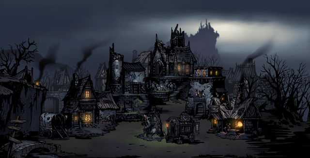

- **Palet / ışık:** Desatüre gri gök; binalar hasarlı (kırık çatılar, eksik kule tepeleri); birkaç pencere hâlâ yanık.
- **Wayborne'a uyarlanacak olan:**
  - Şehirlerin "ihmal edilmiş / düşük refah" durumu için bina hasar katmanı: aynı bina, kırık çatı ve tahtalı pencere overlay'iyle.

#### A-28 — Kızıl gök ve hilal

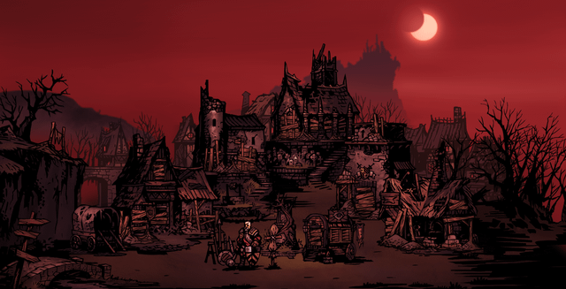

- **Palet / ışık:** Tüm sahne kan kırmızısı monokrom; sağ üstte hilal ay; binalar en hasarlı hâlinde, tahtalarla kapatılmış.
- **Wayborne'a uyarlanacak olan:**
  - Kriz/kuşatma/salgın gibi şehir olayları için tam ekran renk derecelendirmesi (color grade) varyantı — yeni çizim değil, mevcut çizime renk katmanı.

#### A-29 — Sepya, kalabalık

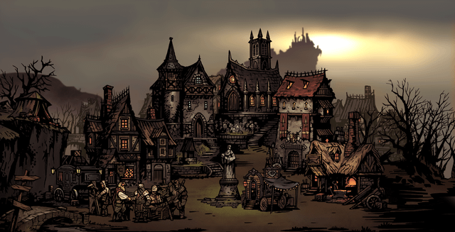

- **Palet / ışık:** Amber-sepya, sıcak; A-26'daki güneş parlaması; binalar onarılmış hâlde.
- **Kompozisyon farkı:** Sol alt ön planda bir grup köylü/figür toplanmış.
- **Wayborne'a uyarlanacak olan:**
  - Pazar günü/festival/varış anı için "kalabalık" ön plan katmanı; figürler ayrı sprite grubu, ekranın sol alt köşesinde, UI'ya taşmadan.

---

## 2. Karakter, stat ve zindan-savaş ekranları

Kaynak: `karakter ve savaş ekranları belgesi (depoda yok)`.

#### K-01 — Karakter stat ekranı

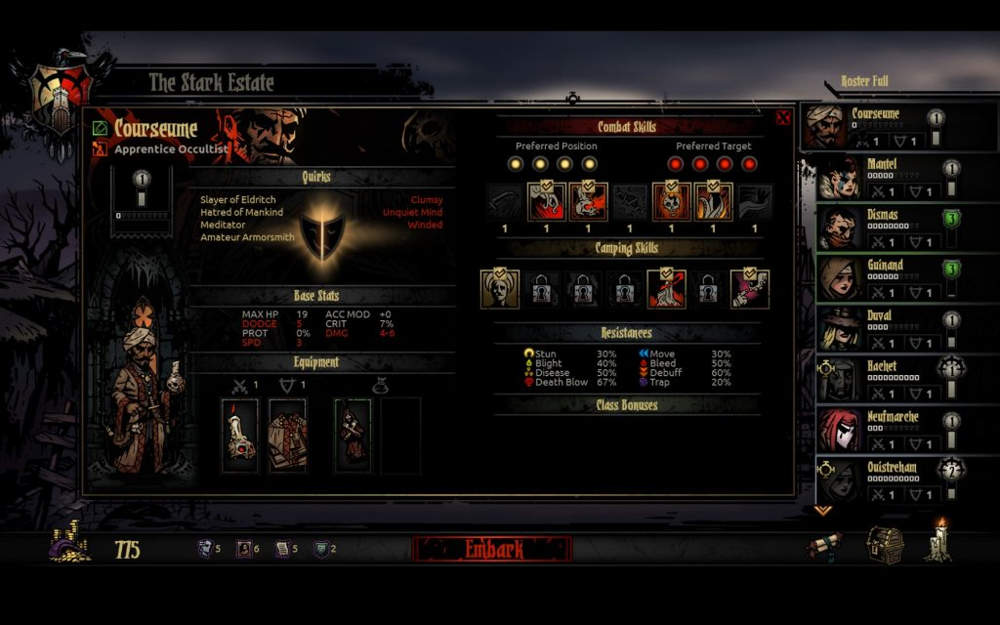

> **Kullanıcı notu (başlık):** "referans oyun Character Stat and Lookout Screen"

- **Ne:** Kasaba ekranının üstüne açılan karakter sayfası paneli (1024×640).
- **Yerleşim:**
  - Sol üstte arma (kalkan + kuzgun) ve yanında koyu şerit üzerinde mülk adı başlığı.
  - Merkezde büyük, ince çerçeveli koyu panel; sağ üstte kırmızı "X" kapatma.
  - Panelin sol sütunu: isim (büyük, gotik başlık fontu, parşömen-sarısı) + sınıf adı; yanında karakterin **büst portresi** bant hâlinde; altında seviye rozeti ve deneyim çubuğu; en altta gotik nişin içinde **tam boy karakter figürü**.
  - Orta-sol: "Quirks" (olumlu özellikler beyaz, olumsuzlar **kırmızı**, iki sütun), ortada parlayan kalkan/maske ikonu; "Base Stats" iki sütunlu sayı tablosu (bazı değerler kırmızı); "Equipment" altında silah/zırh seviye sayıları ve dikey eşya kartları.
  - Sağ yarı: "Combat Skills" — tercih edilen pozisyon (4 sarı nokta) ve hedef (4 kırmızı nokta) göstergeleri; 7 yetenek ikonu (seçililerde onay işareti, kilitliler gri); "Camping Skills" ikon sırası (kilit ikonlu boş yuvalar); "Resistances" iki sütunlu, her satırda renkli küçük ikon + yüzde; "Class Bonuses".
  - Sağ kenarda dikey **roster listesi**: her kartta küçük portre, isim, stres çubuğu (küçük kareler), silah/zırh seviyeleri ve sağda seviye rozeti; üstte "Roster Full".
  - Alt bar: altın yığını ikonu ve miktar, 4 kaynak sayacı, ortada kırmızı çerçeveli **"Embark"** butonu, sağda harita rulosu, sandık ve mum ikonları.
- **Palet / ışık:** Siyah-kömür panel, ince altın/bronz çizgiler, başlıklarda parşömen-sarısı, uyarılarda kırmızı. Arka plandaki kasaba sahnesi koyulaştırılmış ve bulanık değil, sadece kararmış.
- **Tipografi:** Başlıklar ve isimler blackletter/gotik display; gövde metni ve sayılar sade, küçük sans/serif; bölüm başlıkları ortalanmış, iki yanında ince çizgi olan koyu şerit içinde.
- **Çerçeve:** Panel kenarı ince çift çizgi; bölüm başlık şeritleri hafif doku; ikon yuvaları ince kırmızı veya altın kenarlı kare.
- **Wayborne'a uyarlanacak olan:**
  - `character.tscn` için üç sütunlu düzen: sol = portre + tam boy figür + kimlik; orta = özellik/stat tabloları; sağ = yetenek ve direnç ızgaraları. Roster sağ kenarda sabit kalsın.
  - Olumlu/olumsuz özellikleri yalnız renkle (beyaz/kırmızı) ayır; ek ikon gerekmez.
  - Bölüm başlıkları için tek tip "başlık şeridi" bileşeni (koyu şerit + iki yanda ince çizgi + GrenzeGotisch).
  - Pozisyon/hedef tercihini nokta dizisiyle göster (kervan düzeni/savaş sırası için).

#### K-02 — Keşif ekranı ve alt kontrol paneli

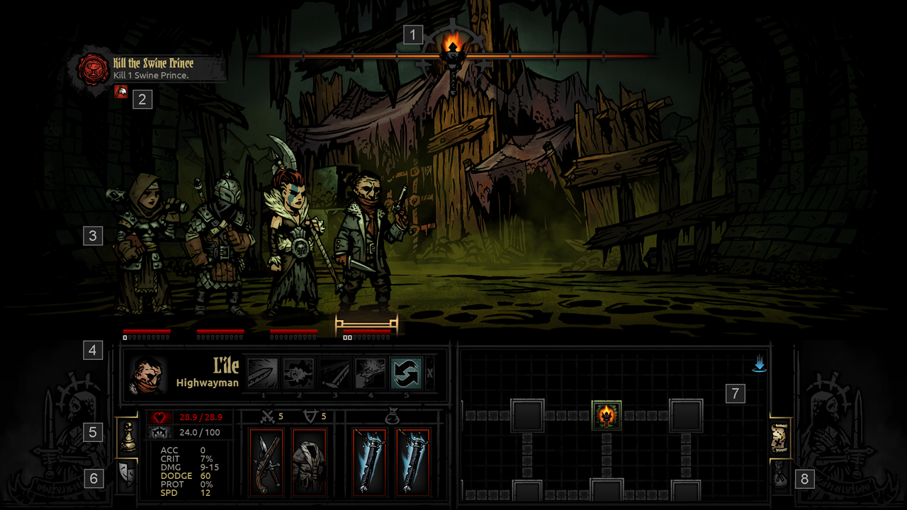

> **Kullanıcı notu:** "Dungeon esnasında keşifte ekran da bu şekilde. Bu şekilde ilerleniyor dungeon’da. Aşağıdaki kontrol paneli önemli. Haritayı, envanteri, karakter stat ve eşyalarını vs görüyoruz."

- **Ne:** Keşif sırasındaki ana oyun ekranı (1280×720). Görselde rehber amaçlı **1–8 numaralı gri etiketler** var (orijinal oyunda değil, kaynak görüntüye eklenmiş).
- **Yerleşim:**
  - Üst orta (1): yatay ince çubuk ve ortasında meşale/ışık simgesi — ışık seviyesi göstergesi.
  - Sol üst (2): kırmızı mühürlü görev kartı ("Kill the Swine Prince") ve altında küçük ikon.
  - Ekranın üst ~%60'ı (3): sahne şeridi; dört kahraman soldan sağa yan yana, ayaklarının altında kırmızı can çubukları ve küçük stres kareleri; seçili kahramanın altında altın köşeli seçim çerçevesi.
  - Alt ~%35 kontrol paneli, iki yarıdan oluşuyor:
    - Sol (4–6): seçili kahraman portresi, isim (büyük) + sınıf, 5 yetenek ikonu + pozisyon değiştir; can (kırmızı kalp) ve stres değerleri; stat listesi (ACC, CRIT, DMG, DODGE, PROT, SPD); silah/zırh kartları ve iki trinket yuvası. Solda iki dikey sekme düğmesi.
    - Sağ (7–8): ızgaralı harita — oda kareleri ve aralarında koridor kareleri, mevcut odada meşale ikonu; sağda dikey sekme düğmeleri (harita/envanter).
  - Panelin iki dış kenarında, kılıç tutan iskelet/heykel kabartması süsleme olarak.
- **Palet / ışık:** Sahne sarımsı-yeşil, panel siyah-kömür; kırmızı can çubukları; altın seçim vurgusu.
- **Wayborne'a uyarlanacak olan:**
  - Yol HUD'ı için aynı **üst sahne / alt panel** ayrımı: üstte kervan şeridi (araba, hayvan, ekip), altta seçili üye + envanter/harita sekmeli panel.
  - Üst orta ışık çubuğu ↔ bizim **SurvivalGauge**: ince yatay çubuk + ortada sembol (ateş/kandil) + çubuk üstünde düzenli çentikler.
  - Panel kenarlarına simetrik dekoratif kabartma (bizde kervan muhafızı/ yol tanrısı kabartması) — panel boş alanlarını süsler, bilgi taşımaz.
  - Seçili birimi altın köşeli parantez çerçeveyle işaretle.

#### K-03 — Savaş ekranı ve düşman bilgi paneli

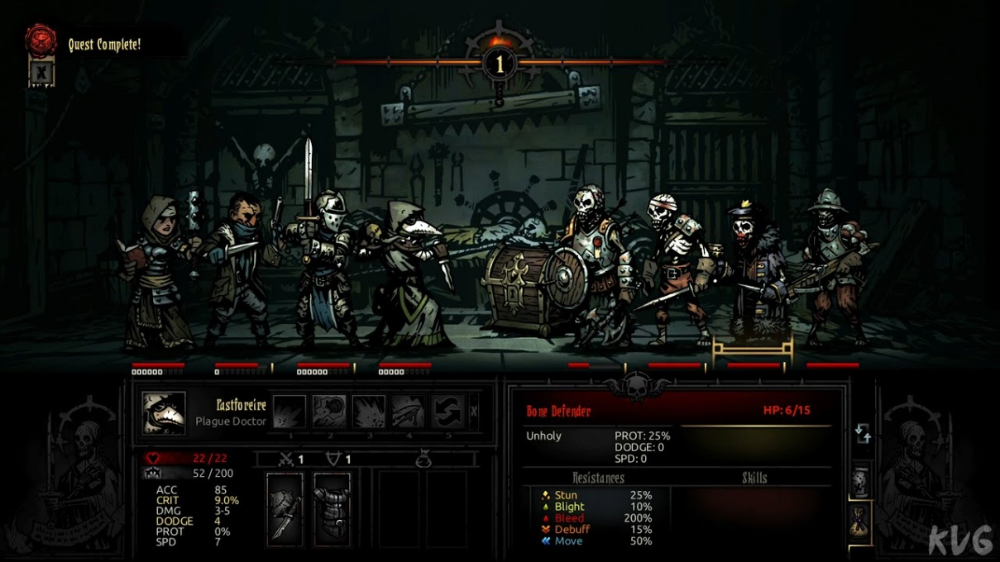

> **Kullanıcı notu:** "Şimdi de kombat sahnesi"

- **Ne:** Savaş sırasındaki ekran (1209×680; sağ altta kaynak videonun filigranı var).
- **Yerleşim:**
  - Üst orta: tur sayacı — dişli/çark biçimli madalyon içinde "1", iki yana uzanan ince kırmızı çubuk.
  - Sol üst: "Quest Complete!" bildirimi ve kırmızı mühür ikonu.
  - Sahne: solda 4 kahraman, sağda 4 düşman (iskelet savaşçılar), ortada bir sandık; her figürün altında can çubuğu; hedeflenen düşmanın altında altın köşeli çerçeve.
  - Alt panel: sol yarı K-02 ile aynı kahraman paneli; **sağ yarı düşman paneli** — kırmızı başlık şeridinde düşman adı ve sağda "HP: 6/15", tür etiketi ("Unholy"), PROT/DODGE/SPD, "Resistances" (renk kodlu ikon + yüzde) ve "Skills" sütunu. Panelin üst ortasında kanatlı kafatası süsü.
- **Palet / ışık:** Sahne koyu gri-yeşil, arka plan mekân çizimi kararmış; düşman panel başlığı kırmızı; direnç ikonları sarı/yeşil/kırmızı/turuncu/mavi.
- **Wayborne'a uyarlanacak olan:**
  - `combat.tscn` alt paneli: sol = aktif üye, sağ = hedef bilgi kartı (başlık şeridi kırmızı = düşman; bizim üyeler için parşömen rengi).
  - Direnç/zayıflık satırları için renk kodlu küçük ikon seti (5–6 tür) — envanter ve karakter ekranıyla ortak.
  - Tur sayacı madalyonu: SurvivalGauge'un dairesel kardeşi olarak aynı çerçeve dilinde.

#### K-04 — Kritik vuruş yakın planı

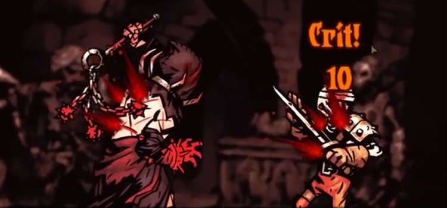

- **Ne:** Savaş aksiyon anı (750×350): kamera yakınlaşmış, iki figür büyük ölçekte.
- **Kompozisyon:** Solda zincirli gürzle saldıran figür, sağda kılıçlı hedef; aralarında kırmızı darbe efektleri ve kan sıçramaları. Sağ üstte turuncu, el yazısı karakterli "Crit!" ve altında hasar sayısı.
- **Palet / ışık:** Arka plan sepya-kırmızıya çekilmiş ve bulanık; figürler keskin.
- **Wayborne'a uyarlanacak olan:**
  - Kritik anlarda arka planı tek renge çek + figürleri yakınlaştır (kamera zoom) — kısa, okunur geri bildirim.
  - Hasar sayıları ve "kritik" yazısı için ayrı, sıcak turuncu, fırça hissi veren bir display stili.

#### K-05 — Kritik vuruş ve ölüm damgası

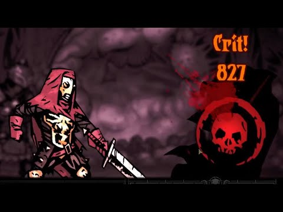

- **Ne:** K-04 ile aynı anın başka örneği (480×360).
- **Kompozisyon:** Solda kırmızı kukuletalı, çift elli kılıçlı figür; sağda hedefin üzerinde **kırmızı daire içinde kafatası damgası**; üstte "Crit!" ve hasar sayısı.
- **Palet / ışık:** Pembe-mor desatüre arka plan; kırmızı vurgular.
- **Wayborne'a uyarlanacak olan:**
  - "Öldürücü vuruş" için mühür/damga grafiği — Wayborne'da mevcut `g9_seal` mühür diliyle uyumlu, kırık mühür (`g9b_seal_cracked`) ailesine yakın bir "ölüm mührü".
  - Damga, hedef figürün göğüs hizasında, kısa bir ölçek-büyüme animasyonuyla.

---

## 3. Kasaba ekranları

Kaynak: `kasaba ekranları belgesi (depoda yok)`. Bu bölümdeki mekân ekranlarının **ortak iskeleti** (T-02 – T-12):

- Arka planda kasaba sahnesi kararmış hâlde görünür.
- Sol üstte arma + mülk adı başlık şeridi (sabit).
- Sol kenarda dikey mekân sekmeleri (her mekân için küçük ikon kutusu).
- Merkezde büyük koyu panel: sol üstte mekân ikonu + gotik başlık; altında kısa açıklama; sağ üstte "Upgraded: %" rozeti; altında yükseltme satırları (ikon + altın çerçeveli zincir halkası gibi dizilmiş yükseltme kareleri + maliyet ikonları).
- Panelin sol yarısında, metnin arkasında silik **mekân sahibi portresi**; sağ yarıda mekâna özel etkileşim alanı (yuvalar, liste, ürünler).
- Sağ kenarda roster listesi; altta kaynak sayaçları ve ikon düğmeleri olan alt bar.

#### T-01 — Kasaba genel görünümü

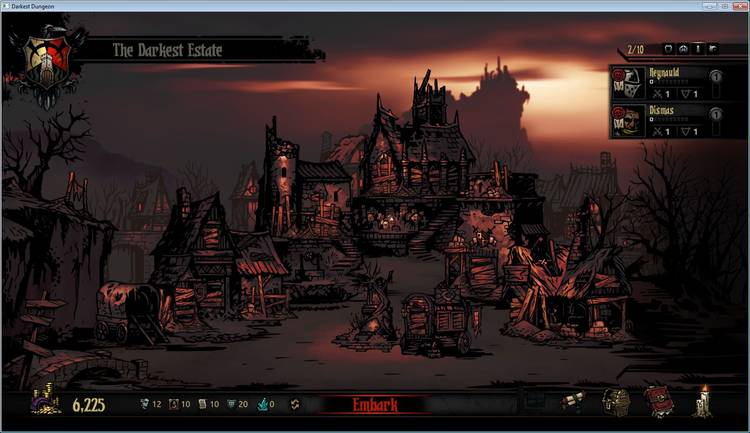

> **Kullanıcı notu:** "Estate görünümü"

- **Ne:** Kasaba ana ekranı (750×433, pencere çerçevesiyle).
- **Yerleşim:** Sol üstte arma ve başlık şeridi; sağ üstte "2/10" roster sayacı, filtre ikonları ve iki roster kartı; tüm orta alan kasaba sahnesi (A-28 kompozisyonunun hasarlı, kızıl-turuncu gün batımı versiyonu); alt bar: altın, kaynak sayaçları, ortada kırmızı "Embark", sağda ikon düğmeleri (harita rulosu, sandık, kırmızı kitap, mum).
- **Palet / ışık:** Kızıl-kahve gün batımı, kale silüeti; binalar tahtalı ve yıkık.
- **Wayborne'a uyarlanacak olan:**
  - CityFront: sahne tüm ekranı kaplasın, UI yalnız üst-sol başlık, sağ roster ve alt bar olarak kenarlarda; bina = tıklanabilir mekân (mevcut `mask.png` yaklaşımı doğru).
  - Alt barın ortasındaki tek kırmızı ana eylem butonu (bizde "Yola çık").

#### T-02 — Posta arabası (işe alım)

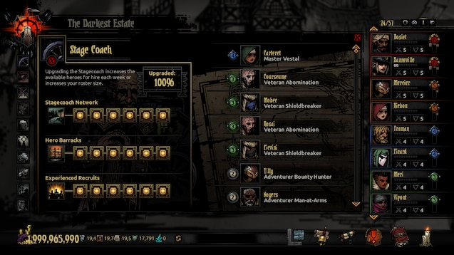

> **Kullanıcı notu:** "Stage Coach"

- **Ne:** İşe alım mekânı (637×358).
- **Yerleşim:** Sol panel: üç yükseltme satırı, her biri 6 altın çerçeveli kare; "Upgraded: 100%" rozeti. Sağ panel: aday listesi — her satırda seviye rozeti, küçük portre, isim ve unvan; dikey kaydırma okları. Sağ kenarda roster (bu örnekte "24/37").
- **Wayborne'a uyarlanacak olan:**
  - `recruit.tscn` için aday satırı bileşeni: rozet + portre + iki satır metin, satırlar arası ince ayraç.
  - Tamamlanmış yükseltme zincirini dolu altın kareler olarak göster.

#### T-03 — Manastır (stres tedavisi)

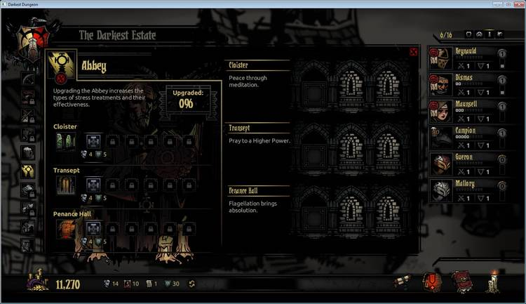

> **Kullanıcı notu:** "Abbey,"

- **Ne:** Kilise/manastır mekânı (750×433).
- **Yerleşim:** Sol: üç bölüm (Cloister, Transept, Penance Hall), her birinde kilitli yükseltme yuvaları; arka planda silik rahip portresi. Sağ: her bölüm için kısa başlık + tek satır açıklama ve yanında **üçer gotik pencere biçimli boş yuva** (kahraman yerleştirme alanı).
- **Wayborne'a uyarlanacak olan:**
  - `church.tscn` için: hizmet yuvaları mekânın mimarisinden türetilmiş biçimde (pencere/niş) — boş yuva bile atmosfer taşır.
  - Her hizmet satırı: başlık + tek cümle + yuvalar.

#### T-04 — Meyhane

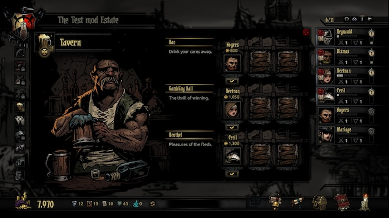

> **Kullanıcı notu:** "Tavern"

- **Ne:** Meyhane (637×358).
- **Yerleşim:** Sol yarı tamamen **büyük, net meyhaneci portresi** (bıyıklı, elinde kupa, arkasında raflar). Sağ: üç hizmet (Bar, Gambling Hall, Brothel), her birinde kısa açıklama, bir yuvada yerleşik kahraman portresi + altın maliyeti + onay işareti, yanında boş ahşap fıçı-doku yuvalar.
- **Palet:** Sıcak kahve-turuncu portre, geri kalan koyu.
- **Wayborne'a uyarlanacak olan:**
  - `tavern.tscn`: mekân sahibi portresi sol yarıyı kaplayacak kadar büyük ve ekranın tek sıcak renk alanı olsun.
  - Yuvaların dokusu mekânın malzemesinden (meyhane = fıçı tahtası).

#### T-05 — Lonca (eğitim)

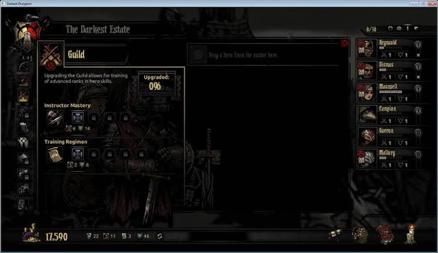

> **Kullanıcı notu:** "Guid"

- **Ne:** Lonca (729×421).
- **Yerleşim:** Sol: iki yükseltme satırı (Instructor Mastery, Training Regimen); arka planda silik zırhlı eğitmen portresi. Sağ: üstte "kahramanı buraya sürükle" tipi boş yuva ve ipucu metni; altı boş.
- **Wayborne'a uyarlanacak olan:**
  - `guild.tscn` boş durumu: tek bir belirgin sürükle-bırak yuvası + kısa ipucu; boş alanı panelle doldurmaya çalışma.

#### T-06 — Demirci

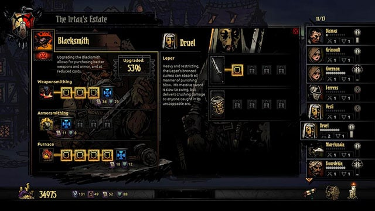

> **Kullanıcı notu:** "Blacksmith"

- **Ne:** Demirci (640×360).
- **Yerleşim:** Sol: üç yükseltme satırı (Weaponsmithing, Armorsmithing, Furnace) — dolu kareler altın, sonraki seviye mavi ikonla; "Upgraded: 53%". Orta: seçili kahraman başlığı (portre + isim + sınıf) ve kısa açıklama. Sağ: silah ve zırh için yatay **seviye merdiveni** (eşya ikonu + bağlantı çizgisiyle bağlı kareler); arka planda silik kahraman büstü.
- **Wayborne'a uyarlanacak olan:**
  - Ekipman yükseltme görselleştirmesi: `eq_weapon_tier_1..3` / `eq_armor_tier_1..3` ikonlarını yatay bağlantılı seviye kareleriyle göster.
  - Seçili üyenin büstünü panelin arkasında silik bırak — kime işlem yapıldığı sürekli görünür.

#### T-07 — Şifahane

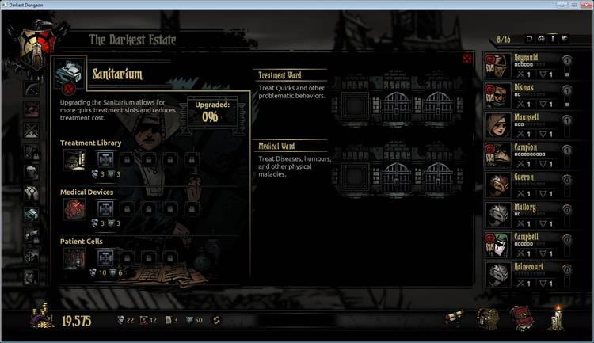

> **Kullanıcı notu:** "Sanitarium"

- **Ne:** Şifahane (750×433).
- **Yerleşim:** Sol: üç yükseltme satırı; arka planda silik doktor portresi ve masada kitap. Sağ: iki bölüm (Treatment Ward, Medical Ward), her biri başlık + kısa açıklama + üçer **demir parmaklıklı kapı biçiminde** yuva.
- **Wayborne'a uyarlanacak olan:**
  - T-03'teki "mimariden türeyen yuva" ilkesinin ikinci örneği: her mekâna kendi yuva çerçevesi (kilise = niş, şifacı = kapı, meyhane = fıçı).

#### T-08 — Göçebe arabası (tılsım satıcısı)

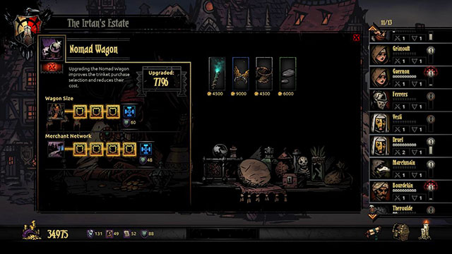

> **Kullanıcı notu:** "Nomad vagon"

- **Ne:** Gezgin satıcı (640×360).
- **Yerleşim:** Sol: iki yükseltme satırı. Sağ üst: dört dikey eşya kartı (koyu zemin, tılsım ikonu) ve altlarında altın fiyatı. Sağ alt: arabanın içi — halı, yastık, kristal küre, sandıklar, şişeler — bir "dükkân tezgâhı" sahnesi olarak çizilmiş.
- **Wayborne'a uyarlanacak olan:**
  - Pazar (`market.tscn`) ve kervan dükkânı: ürün kartları + altında fiyat; boş alanı mekânın küçük bir **tezgâh illüstrasyonuyla** doldur.
  - Bizim temamıza en yakın mekân: araba-dükkân. Kervanın kendi "seyyar tezgâh" görünümü için referans.

#### T-09 — Hayatta kalma kampı

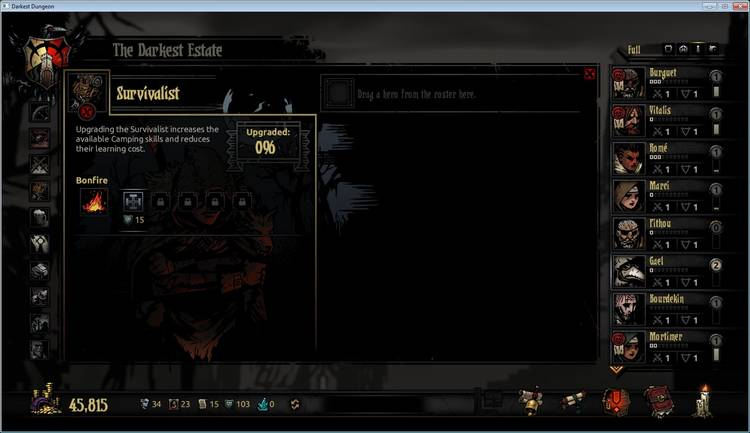

> **Kullanıcı notu:** "Survavilist Camp"

- **Ne:** Kamp becerileri mekânı (750×433).
- **Yerleşim:** Sol: tek yükseltme satırı (Bonfire, ateş ikonu); arka planda silik kurt postlu figür. Sağ: sürükle-bırak yuvası ve ipucu metni, gerisi boş.
- **Wayborne'a uyarlanacak olan:**
  - Kamp/yol becerileri ekranı için ateş ikonu ve kurt postu motifi; boş durum düzeni T-05 ile aynı tutulabilir (tutarlılık).

#### T-10 — Ata anıları

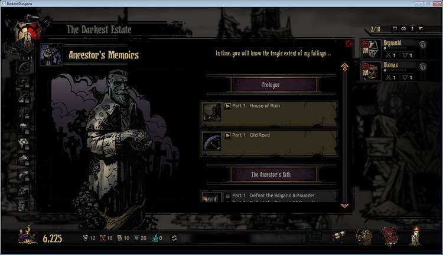

> **Kullanıcı notu:** "Ancestor’s Memories"

- **Ne:** Hikâye/günlük ekranı (750×433).
- **Yerleşim:** Sol yarıda büyük, mor tonlu, mezarlık önünde duran yaşlı adam illüstrasyonu. Sağ: üstte italik kısa alıntı; mor başlık şeritleri ("Prologue", "The Ancestor's Path") altında bölüm satırları — küçük kare görsel, oynat oku, "Part 1" ve başlık; kilitli satırlarda kilit ikonu; dikey kaydırma.
- **Palet:** Diğer mekânlardan farklı olarak **mor** vurgu rengi; satır zeminleri koyu zeytin.
- **Wayborne'a uyarlanacak olan:**
  - Waybook/defter içindeki "hikâye kayıtları" bölümü: bölüm başlık şeridi + küçük görsel + oynat düğmesi + kilit durumu.
  - Her ana ekran türüne bir aksan rengi: hikâye = mor, savaş = kırmızı, ticaret = altın gibi.

#### T-11 — Mezarlık

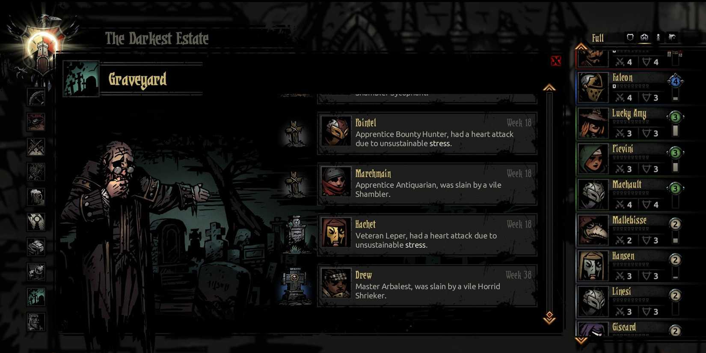

> **Kullanıcı notu:** "Graveyard,"

- **Ne:** Ölen kahramanlar listesi (1650×825 kaynak, yüksek çözünürlük).
- **Yerleşim:** Sol: gözlüklü, paltolu mezarcı figürü eliyle listeyi gösteriyor; arkasında mezar taşları ve ağaç. Sağ: kartlar listesi — her kartın solunda mezar işareti (tahta haç ya da taş haç; daha yüksek seviyede daha süslü), portre, isim (gotik), sağ üstte "Week 18" gibi zaman bilgisi, altında tek cümlelik ölüm nedeni (anahtar kelime vurgulu). Sağ kenarda roster; kartların sol kenarındaki renk, seviye rozetinin rengiyle uyumlu.
- **Wayborne'a uyarlanacak olan:**
  - Waybook/ledger'da **"Düşenler" sayfası**: mezar işareti + portre + isim + hafta/gün + tek cümle neden. Mezar işaretinin süslemesi üyenin rütbesine göre artsın.
  - Ölüm nedeni cümlesinde tek anahtar kelimeyi vurgula (renk/ağırlık).

#### T-12 — Erzak dükkânı

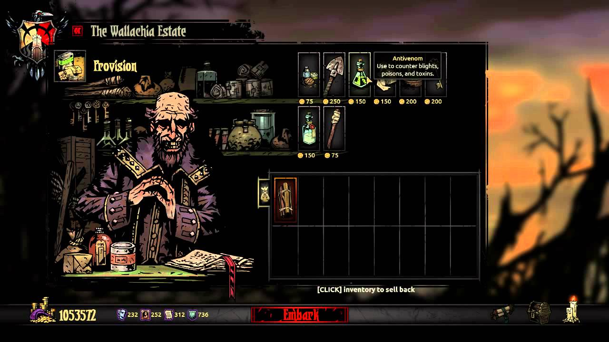

> **Kullanıcı notu:** "Provisions"

- **Ne:** Sefer öncesi erzak alımı (1280×720).
- **Yerleşim:** Başlıkta geri oku ve mülk adı. Panelin solunda raflar önünde **büyük, net satıcı portresi**, masada şişeler ve kitap. Sağ üstte dikey ürün kartları (iksir, kürek, meşale vb.), her birinin altında altın ikonu + fiyat; bir ürünün üstünde **tooltip** (koyu kutu, ince altın kenar, başlık + iki satır açıklama). Altında 2×8'lik **envanter ızgarası**, sol kenarında torba ikonlu sekme; ızgaranın altında "[CLICK] inventory to sell back" ipucu. Panelin sağında kasaba sahnesi turuncu gün batımıyla görünüyor; alt bar tam hâlinde ("Embark" ortada).
- **Wayborne'a uyarlanacak olan:**
  - `market.tscn` ve sefer öncesi hazırlık: üstte satılık kartlar, altta kervan envanter ızgarası, arada tek satır ipucu.
  - Tooltip bileşeni: koyu zemin + ince altın kenar + başlık (açık renk) + kısa açıklama; tüm ekranlarda aynı.
  - Panel tüm ekranı kapatmasın; sağda sahnenin bir şeridi açık kalsın (mekân hissi).

---

## 4. Ortak görsel dil

Üç belgedeki tekrar eden ilkeler:

### Palet
- **Desatüre taban + tek doygun vurgu.** Her sahnede baskın renk bir aileye indirgenmiş (gri-yeşil, kahve-turuncu, lacivert-camgöbeği, mor); doygun renk tek bir odak öğesinde (halı, ateş, su, pencere ışıkları).
- **UI paleti sabit:** kömür-siyah panel, ince altın/bronz kenar, parşömen-sarısı başlık, kırmızı = olumsuz/tehlike/ana eylem, beyaz/gri = nötr metin. Mor yalnız hikâye ekranında aksan.
- **Durum = renk derecelendirmesi:** aynı sahne gece-mor, akşam-amber, gri-kasvetli, kan-kırmızısı varyantlarla anlam değiştiriyor (A-25 – A-29, A-01/A-06).

### Işık
- Tek baskın ışık kaynağı (mum, mangal, gökteki parlama, su); kenarlar her zaman siyaha düşen vinyet.
- Arkadan aydınlatma + ön plan siluet ile derinlik (A-10, A-12, A-15, A-26).
- Küçük renkli ışık noktaları (büyü küresi, pencere) karanlık sahnede göz çapası.

### Çerçeveleme ve kompozisyon
- Sahneler geniş şerit (≈2.3–2.7:1); tam ekranda üst/alt koyu bantlar UI'ya ayrılır.
- Mekân/boss sahnelerinde **simetri ve merkezde tek odak**; geçiş/koridor sahnelerinde modüler, yatay tekrar edilebilir duvar ritmi.
- UI her zaman **kenarlarda**: sol üst kimlik (arma + başlık), sağ kenar roster, alt kenar kaynaklar + tek ana eylem, sol kenar dikey sekmeler. Merkez sahneye ya da tek büyük panele bırakılıyor.

### Yoğunluk
- Bilgi yoğun ekranlarda (K-01, K-03, T-12) yoğunluk **gruplanmış bloklarla** yönetiliyor: başlık şeridi + iki sütunlu küçük tablo. Boş durumlar (T-05, T-09) bilerek boş bırakılıyor.
- Mekân panellerinde metnin arkasında silik büyük portre: boşluğu doldurur ama okunurluğu bozmaz.

### Tipografi
- İki katman: **gotik/blackletter display** (isimler, mekân başlıkları, "Embark", "Crit!") + **sade küçük gövde** (açıklama, sayı, stat). Wayborne'daki `GrenzeGotisch` (display) + `EBGaramond`/`IMFellEnglishSC` (gövde/küçük başlık) eşleşmesi bu yapıya oturuyor.
- Renkle anlam: parşömen-sarısı başlık, kırmızı negatif değer, beyaz nötr.

### Çerçeve, süsleme ve bileşenler
- İnce çift çizgili panel kenarı, köşelerde ağır süsleme yok; süs panel dışına (arma, kenar kabartmaları, kanatlı kafatası tepeliği) taşınmış.
- Tekrar eden bileşenler: başlık şeridi, yükseltme karesi (boş/dolu/kilitli/sonraki), roster kartı, seviye rozeti, kaynak sayacı, kırmızı ana eylem butonu, tooltip, ızgara envanter, seçim köşeli parantezi, tur madalyonu.

### Hareket ipuçları (görüntülerden çıkarılabilen)
- Belgedeki notlar arka planların savaş/keşif sırasında "arkada dinamik olarak akan" katmanlar olduğunu belirtiyor; görsellerde bırakılmış boş/beyaz delikler (A-05) paralaks katman yapısını doğruluyor.
- Ayrı katmana uygun öğeler: bacalardan duman, pencere ışıkları, ışık huzmeleri, sis (A-20, A-26), mangal ateşleri.
- Savaşta kritik anlar için yakınlaşma + arka planı tek renge çekme + büyük sayı/damga (K-04, K-05).

---

## 5. İkinci art çalışması için önerilen iş listesi

Notlar:
- Görsel referanslar "referans oyun"dan alınmıştır; aşağıdaki işler ilke uyarlamasıdır, birebir kopya değildir.
- Önerilen yeni asset adları mevcut klasör yapısını izler (`data/assets/ui/...`). **Hiçbir dosya, sınıf ya da asset adında referans oyunun adı, kısaltması ya da küçük köy türünün eski adı geçmez.** "grim" ön eki kabul edilebilir.
- Mevcut ekranlar: CityFront (şehir), ana menü (gece kampı), SurvivalGauge'lu yol HUD'ı, pazar/envanter, karakter, savaş, waybook/defter.

1. **Ortak UI kiti (grim kit v2) — panel, başlık şeridi, buton, tooltip**
   Referans: K-01, K-03, T-02 – T-12, Bölüm 4.
   Yeni asset: `ui/grim/kit/panel_frame.png` (9-slice), `section_strip.png`, `action_button_red.png` + `_hover` + `_pressed`, `tooltip_plate.png` (9-slice), `select_brackets.png`.
   Kabul kriteri: Tüm mekân, karakter ve savaş panelleri aynı 9-slice çerçeveyi kullanır; başlık şeridi GrenzeGotisch ile 1080p'de min. 28 px okunur; tooltip ve buton durumları (normal/hover/pressed/disabled) tek sprite sayfasında; mevcut `plate.png`/`plate_hover.png` ile görsel olarak çelişmez (ya yerine geçer ya da aynı kenar dilini kullanır).

2. **Ana menü — gece kampı arka planı (katmanlı)**
   Referans: A-25, A-19, A-10, A-17 (mum kümeleri).
   Yeni asset: `ui/menu/camp_night_sky.png`, `camp_night_far.png`, `camp_night_mid.png`, `camp_night_fore.png`, `camp_fire_glow.png`, `camp_smoke_strip.png`.
   Kabul kriteri: Mor-lacivert gök + tek sıcak kaynak (kamp ateşi) + kenar vinyeti; logo ve menü butonları için merkezde ya da solda karanlık, düşük detaylı bir alan bırakılmış; ateş ışığı ve duman ayrı katmanda, döngüsel animasyona uygun; 1920×1080'de üst/alt %15 bant UI'ya ayrılmış.

3. **CityFront — durum varyantlı şehir arka planları**
   Referans: A-25 – A-29, T-01.
   Yeni asset (şehir başına, ör. `ui/towns/demirkapi/`): `background_dusk.jpg`, `background_night.jpg`, `background_grey.jpg`, `background_crisis.jpg`, `windows_glow.png`, `light_shafts.png`, `damage_overlay.png`, `crowd_fore.png`.
   Kabul kriteri: Tüm varyantlar mevcut `mask.png` ile piksel hizalı (bina tıklama alanları değişmez); durum farkı yalnız gök/ışık/overlay katmanlarıyla; kriz varyantı tek renk derecelendirmesi; kalabalık katmanı sol altta ve alt bara taşmıyor; 6 şehrin hepsi aynı ışık yönü kuralına uyuyor.

4. **Mekân ekranları (venue) — ortak iskelet + mekâna özgü yuvalar**
   Referans: T-02 – T-09, T-12.
   Yeni asset: `ui/venues/keeper_tavern.png`, `keeper_market.png`, `keeper_church.png`, `keeper_guild.png`, `keeper_yard.png`, `keeper_recruit.png` (büyük sahip portreleri); `slot_church_niche.png`, `slot_tavern_barrel.png`, `slot_healer_gate.png`; `upgrade_pip_empty/filled/locked/next.png`.
   Kabul kriteri: Her mekân aynı iskeleti kullanır (sol üst ikon + başlık, açıklama, "geliştirme %" rozeti, sol yarıda silik ya da net sahip portresi, sağ yarıda etkileşim alanı); her mekânın yuva çerçevesi kendi mimarisinden türetilmiş; boş durumlar (ör. lonca) tek yuva + ipucuyla çözülmüş; mevcut `b1`–`b8` waybook arka planlarıyla ton uyumlu.

5. **Pazar / erzak ve envanter ekranı**
   Referans: T-12, T-08, A-13.
   Yeni asset: `ui/market/goods_card.png`, `goods_card_hover.png`, `inventory_cell.png`, `inventory_tab_bag.png`, `stall_vignette.png` (tezgâh illüstrasyonu), `price_coin_small.png`.
   Kabul kriteri: Üstte ürün kartları + altında fiyat, altta kervan envanter ızgarası, arada tek satır ipucu; tooltip kit bileşeninden geliyor; panelin bir yanında şehir sahnesinden şerit açık; ürün ikonları (`item_*`, `eq_*`) kart içinde kırpılmadan ortalanıyor.

6. **Karakter / stat ekranı yeniden düzeni**
   Referans: K-01, K-02 (alt panel stat bloğu), T-06.
   Yeni asset: `ui/character/sheet_portrait_frame.png`, `sheet_figure_niche.png`, `trait_icon_good.png`, `trait_icon_bad.png`, `resist_icons.png` (renk kodlu ikon sayfası), `position_pips.png`, `rank_badge_1..5.png`.
   Kabul kriteri: Üç sütun (kimlik+figür / özellik+stat / yetenek+direnç); olumlu-olumsuz özellik yalnız renkle ayrılıyor; roster sağ kenarda sabit; tüm metinler 1280×720'de okunur; ekipman kartları `eq_*_tier_*` ikonlarını kullanıyor.

7. **Roster kartı ve seviye rozeti**
   Referans: K-01, T-02, T-11.
   Yeni asset: `ui/grim/kit/roster_card.png`, `roster_card_selected.png`, `roster_card_wounded.png`, `stress_pip.png`, `rank_badge_*.png` (madde 6 ile ortak).
   Kabul kriteri: Kart portre + isim + durum çubuğu (küçük kareler) + iki seviye sayısı + rozet içeriyor; seçili ve yaralı durum ayırt edilebilir; 10+ kart dikey kaydırmada taşmıyor.

8. **Savaş ekranı — alt panel, hedef kartı, tur madalyonu, kritik efektleri**
   Referans: K-03, K-02, K-04, K-05, A-18.
   Yeni asset: `ui/combat/turn_medallion.png`, `target_card_header_red.png`, `ally_card_header_parchment.png`, `hp_bar_small.png`, `crit_flash_grade.png` (tam ekran renk katmanı), `deathblow_seal.png`, `damage_numbers` için display font stili.
   Kabul kriteri: Alt panel sol = aktif üye, sağ = hedef; direnç ikonları madde 6'daki setle aynı; kritik vuruşta arka plan tek renge çekiliyor ve figürler yakınlaşıyor (≤0.6 sn), ölüm mührü `g9_seal` diliyle uyumlu; özel karşılaşma arka planları simetrik ve merkez odaklı.

9. **Yol HUD'ı — SurvivalGauge ve alt kontrol paneli**
   Referans: K-02, K-03 (tur madalyonu), A-10 (bant yapısı).
   Yeni asset: `ui/road/hud/survival_gauge_bar.png`, `survival_gauge_emblem.png` (kandil/ateş), `survival_gauge_ticks.png`, `road_panel_frame.png`, `road_panel_relief_left.png`, `road_panel_relief_right.png`.
   Kabul kriteri: Gauge üst ortada ince yatay çubuk + ortada sembol + düzenli çentikler; değer düştükçe sembolün ışığı azalıyor; alt panel üye bilgisi + harita/envanter sekmeleri içeriyor; kenar kabartmaları bilgi taşımıyor, yalnız süs; sahne alanı ekranın en az %55'i.

10. **Yol arka planları — biyom başına katmanlı set ve durum varyantları**
    Referans: A-03, A-05, A-07, A-09, A-10, A-12, A-14, A-16, A-20, A-21, A-24.
    Yeni/güncellenen asset: mevcut `ui/road/<forest|lake|marsh|mountain|steppe>/far.png, mid.png, ground.png, fore.png` + her biyoma `mid_alt.png` (yıkık/hasarlı modül), `fog_strip.png`, `wreck_prop.png` (kervan enkazı), `night_grade.png`.
    Kabul kriteri: Uzak katman soğuk/tek tonlu siluet, ön katman sıcak; orta katman yatayda dikişsiz tekrar ediyor ve en az bir varyant modülü var; ön katmanda arkayı gösteren boşluklar; sis ayrı katmanda kayıyor; gece varyantında parlaklık düşük, ışık yalnız ufukta; her biyom tek bir doygun vurgu rengine sahip (göl = camgöbeği su, bataklık = zeytin-turuncu).

11. **Waybook / defter — hikâye kayıtları ve "Düşenler" sayfası**
    Referans: T-10, T-11, A-02, A-14, A-22.
    Yeni asset: `ui/waybook/chapter_strip_violet.png`, `chapter_row.png`, `chapter_row_locked.png`, `fallen_row.png`, `fallen_marker_wood.png`, `fallen_marker_stone.png`, `fallen_marker_ornate.png`, `ledger_backdrop.png`.
    Kabul kriteri: Hikâye satırı = küçük görsel + oynat + başlık + kilit durumu, mor aksanla; "Düşenler" satırı = mezar işareti (rütbeye göre 3 kademe) + portre + isim + gün/hafta + tek cümle neden (anahtar kelime vurgulu); arka plan duvarsız, siyah boşlukta raf/mum/kitap.

12. **Kilise ve mezarlık arka planı (mekân sahnesi)**
    Referans: A-01, A-06, A-14, T-03.
    Yeni asset: `ui/venues/church_calm.jpg`, `church_vigil.jpg` (mangallı/tehlikeli varyant), `church_slot_niche.png`.
    Kabul kriteri: Simetrik eksen, merkezde tek sıcak ışık, zeminde merkeze çeken yol; iki varyant aynı çizimden yalnız ışık/props katmanıyla türetilmiş; mevcut `b5_church.jpg` ile ton geçişi kopuk değil.

13. **İsimlendirme temizliği (art tarafı)**
    Referans: kullanıcının isimlendirme kuralı.
    İş: Mevcut `data/assets/ui/waybook/e6j_mezra.jpg` dosyasının adı kurala takılıyor ("mezra" içeriyor). Yeni ad önerisi: `e6j_village.jpg` (ya da `e6j_settlement.jpg`); koddaki referansıyla (`scripts/ui/road_journey.gd`) birlikte yeniden adlandırılmalı.
    Kabul kriteri: Proje içinde dosya/sınıf/asset adlarında "referans oyun", "referans oyun", "referans oyun", "mezra" araması (büyük-küçük harf dikkate alınarak, kelime içi eşleşmeler ayrıca gözden geçirilerek) sıfır sonuç verir; yeni eklenen tüm assetler bu kontrolden geçer.
