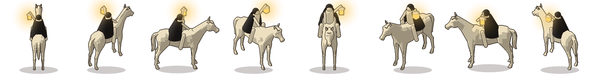
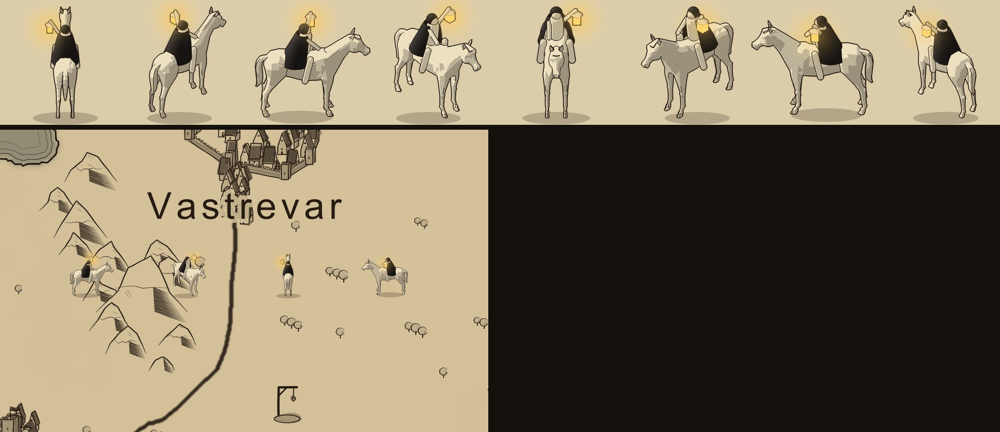

# Oyuncu harita işareti: atlı (kullanıcı onaylı, 2026-10-17)

**Onaylı sürüm:** Haritada oyuncunun (kervanın) konumunu gösteren işaret. Bir at ve binicisi; binici siyah pelerinli, başında yuvarlak bir kukuleta, sol eli dizginde, sağ eli havada ışıldayan bir fener tutuyor.

**Görseller:** `../referanslar/atli_isaret/gorseller/`

| Dosya | Ne |
|---|---|
| `atli_sayfa.png` | 8 yön yan yana: K, KD, D, GD, G, GB, B, KB |
| `atli_<yön>_256.png` | Her yön ayrı, 256 px, saydam |
| `atli_onizleme_haritada.jpg` | Haritanın üstünde, oyundaki gerçek boyutuyla |
| `atli_yonler.json` | Yön açıları ve bağlama noktası (`anchor`: tırnakların ortası) |

**Oyunda kullanılacak tam set:** 64, 96, 128 ve 256 px. Konum `../harita_final/isaret_atli/`.

**Nasıl üretildi:**
- **At:** Depodaki 3D at modeli (`art_source/models/animals/quaternius_gltf/glTF/Horse.gltf`, CC0).
- **Binici:** Aynı sahnede kurulan basit 3D parçalar: gövde, bacaklar, kollar, baş, kukuleta, önü açık pelerin, fener.
- **Kamera:** Haritadaki dağlarla aynı 35° yukarıdan-yandan açı, 8 yönden render edildi.
- **Mürekkep dili:** Kâğıt dolgu, mürekkep hat, gölge tarafında 45° tarama. Siyah pelerinin ışık alan yüzlerinde hafif gri açılma. Fener camı sıcak sarı.
- **Işıltı:** Fenerin çevresinde saydam bir hale; nesnenin üstünde hafif aydınlatma.
- **Betik:** `xx/Harita_Calismasi/kod/cm/rider_marker.py`.
  - `CLOAK`: pelerin rengi
  - `EL`: kamera açısı
  - `rider()`: binicinin oranı ve fenerin yeri
  - `ink()`: ışıltının yarıçapı ve gücü

**Yön seçimi:** Gidiş vektörünün açısı en yakın 45°'ye yuvarlanır.
- `index = round(atan2(dy, dx) / 45°) mod 8`
- sıra: `D, GD, G, GB, B, KB, K, KD`
- 0° sağa, 90° aşağı, yani ekran koordinatı.

**Kullanıcı kararları:**
- İlk madalyonlu kervan işareti beğenilmedi. Eski önerilerin görselleri `../harita_final/isaret/` altında.
- "En uygunu bir at ve binicisi; yola göre farklı açılardan görülebilmeli."
- "Siyah bir pelerin tercih ederim."
- "Eline bir fener ekle, bir eli havada fener tutsun, fenerden ışıldama gelsin."

**Gelecek için:**
- Gece haritasında (§8.10) fener ışıltısı biraz güçlendirilebilir.
- Yürürken hafif bir sallanma ya da adım animasyonu, at modelinin animasyon karelerinden aynı yöntemle render edilebilir.
