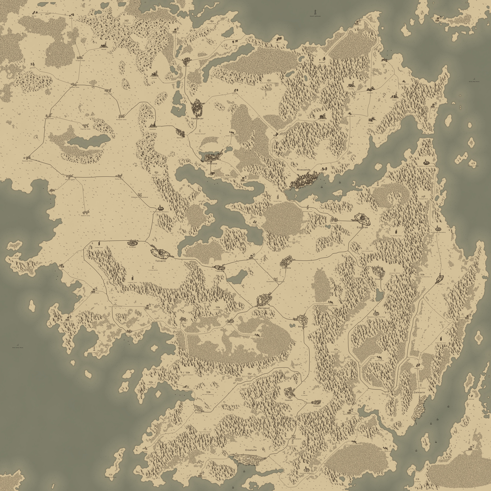

# Wayborne atlası (harita v3)

Görev 8.8, 2026-10-19. Eski atlas sayfası (claude.ai yayını) okunamadı; bu belge yeni haritayla güncel hâli. Kaynak:
`wayborne/data/config/settlements.json` (GeoJSON'dan `build_settlements.py` ile).

Ölçek: kuzeyden güneye 61 gün (Auderin - Orsolune). Yol sayısı: 41.

## Vadi

| Ad (tr / en / zh) | Tür | Üretir | Arar | Komşular |
|---|---|---|---|---|
| **Belvanor** / Belvanor / 贝尔瓦诺 | Şehir (özgür şehir) | şarap, kumaş | silah, mücevher, baharat | Ilsande, Merigaud, Mirsana |
| **Ilsande** / Ilsande / 伊尔桑德 | Şehir (özgür şehir) | ipek, şarap | kürk, silah, bal | Belvanor, Caramine, Mirsana, Seyvan Kervansarayı |
| **Merigaud** / Merigaud / 梅里戈 | Şehir (şehir) | tahıl, şarap | silah, kürk, balık | Belvanor, Liraven, Duvenmor Kervansarayı |
| **Ondrelle** / Ondrelle / 翁德蕾尔 | Şehir (özgür şehir) | tahıl, bal | silah, balık, kumaş | Ezmerak, Orvahel, Duvenmor Kervansarayı |
| **Caramine** / Caramine / 卡拉明 | Kasaba (kasaba) | şarap, tahıl | balık, kürk | Ilsande, Seyvan Kervansarayı |
| **Liraven** / Liraven / 利拉文 | Kasaba (bataklık kasabası) | balık, ilaç | tahıl, kumaş | Merigaud, Mirsana, Samuran |
| **Duvenmor Kervansarayı** / Duvenmor Caravanserai / Duvenmor Caravanserai | Kervansaray (kervansaray) | ipek, şarap | baharat, kürk | Akavan, Merigaud, Ondrelle |

## Kuzey imparatorluğu

| Ad (tr / en / zh) | Tür | Üretir | Arar | Komşular |
|---|---|---|---|---|
| **Dravoss** / Dravoss / 德拉沃斯 | Şehir (şehir) | silah, tahıl | şarap, bal, ilaç | Selvicar |
| **Rivecande** / Rivecande / 里维坎德 | Şehir (liman şehri) | balık, kürk | tahıl, şarap, baharat | Golcavar, Kesgrav, Vastrevar |
| **Vastrevar** / Vastrevar / 瓦斯特雷瓦 | Şehir (şehir) | silah, kumaş | baharat, şarap, ipek, mücevher | Auderin, Rivecande, Selvicar |
| **Auderin** / Auderin / 奥德林 | Kasaba (kasaba) | kürk | tahıl, şarap | Vastrevar |
| **Selvicar** / Selvicar / 塞尔维卡 | Kasaba (kasaba) | tahıl | kumaş, şarap | Dravoss, Orbeyan Kervansarayı, Vastrevar |

## Sınır halkları

| Ad (tr / en / zh) | Tür | Üretir | Arar | Komşular |
|---|---|---|---|---|
| **Ezmerak** / Ezmerak / 埃兹梅拉克 | Şehir (şehir) | bal, kürk | tahıl, kumaş, baharat | Golcavar, Ondrelle, Orvahel |
| **Tolvarin** / Tolvarin / 托尔瓦林 | Şehir (şehir) | kürk, tahıl | silah, kumaş, şarap | Akavan, Kirsavel, Orbeyan Kervansarayı |
| **Akavan** / Akavan / 阿卡万 | Kasaba (kasaba) | bal, tahıl | kumaş, balık | Duvenmor Kervansarayı, Tolvarin |
| **Golcavar** / Golcavar / 戈尔贾瓦尔 | Kasaba (bataklık kasabası) | ilaç, balık | tahıl, silah | Ezmerak, Rivecande |
| **Kirsavel** / Kirsavel / 基尔萨维尔 | Kasaba (kasaba) | tahıl | silah, ilaç | Samuran, Orbeyan Kervansarayı, Tolvarin |
| **Samuran** / Samuran / 萨穆兰 | Kasaba (bataklık kasabası) | ilaç, balık | tahıl, kumaş | Kirsavel, Liraven, Mirsana |

## Dağ kabileleri

| Ad (tr / en / zh) | Tür | Üretir | Arar | Komşular |
|---|---|---|---|---|
| **Brazdun** / Brazdun / 布拉兹敦 | Kasaba (maden kasabası) | silah, mücevher | tahıl, kumaş | Kesgrav |
| **Kesgrav** / Kesgrav / 凯斯格拉夫 | Kasaba (maden kasabası) | silah | tahıl, şarap | Brazdun, Rivecande |

## Dağ madenleri

| Ad (tr / en / zh) | Tür | Üretir | Arar | Komşular |
|---|---|---|---|---|
| **Vorgat** / Vorgat / 沃尔加特 | Kasaba (nehir kasabası) | mücevher, balık | tahıl, kumaş | Orsolune, Orvahel, Seyvan Kervansarayı, Zelmarin |

## Güney liman kentleri

| Ad (tr / en / zh) | Tür | Üretir | Arar | Komşular |
|---|---|---|---|---|
| **Orsolune** / Orsolune / 奥尔索伦 | Şehir (liman şehri) | baharat, balık | kürk, silah, tahıl | Orvahel, Seyvan Kervansarayı, Vorgat, Zelmarin |
| **Zelmarin** / Zelmarin / 泽尔马林 | Şehir (liman şehri) | mücevher, baharat | tahıl, şarap, kürk | Orsolune, Orvahel, Seyvan Kervansarayı, Vorgat |
| **Mirsana** / Mirsana / 米尔萨娜 | Kasaba (pazar kasabası) | baharat, kumaş | tahıl, balık | Belvanor, Ilsande, Liraven, Samuran |
| **Seyvan Kervansarayı** / Seyvan Caravanserai / Seyvan Caravanserai | Kervansaray (kervansaray) | baharat, mücevher | şarap, tahıl | Caramine, Ilsande, Orsolune, Orvahel, Vorgat, Zelmarin |

## Ahit

| Ad (tr / en / zh) | Tür | Üretir | Arar | Komşular |
|---|---|---|---|---|
| **Orvahel** / Orvahel / 奥尔瓦赫尔 | Şehir (özgür şehir) | ilaç, kumaş | şarap, bal, mücevher | Ezmerak, Ondrelle, Orsolune, Seyvan Kervansarayı, Vorgat, Zelmarin |

## Göçebe boylar

| Ad (tr / en / zh) | Tür | Üretir | Arar | Komşular |
|---|---|---|---|---|
| **Orbeyan Kervansarayı** / Orbeyan Caravanserai / Orbeyan Caravanserai | Kervansaray (kervansaray) | kürk, baharat | kumaş, silah | Kirsavel, Selvicar, Tolvarin |

## Yollar

| Yol | Gün | Tehlike | Arazi |
|---|---|---|---|
| Akavan - Duvenmor Kervansarayı | 5 | %12 | bozkır > çayır |
| Akavan - Tolvarin | 4 | %25 | orman > göl kıyısı |
| Auderin - Vastrevar | 5 | %24 | göl kıyısı |
| Belvanor - Ilsande | 6 | %12 | çayır |
| Brazdun - Kesgrav | 2 | %48 | dağ |
| Caramine - Ilsande | 3 | %25 | çayır |
| Caramine - Seyvan Kervansarayı | 5 | %37 | çayır > dağ |
| Ezmerak - Ondrelle | 10 | %28 | bataklık > çayır |
| Ezmerak - Orvahel | 8 | %33 | bataklık > bozkır |
| Golcavar - Ezmerak | 2 | %38 | bataklık |
| Golcavar - Rivecande | 8 | %27 | bataklık > göl kıyısı > dağ |
| Ilsande - Seyvan Kervansarayı | 4 | %23 | çayır > dağ |
| Kesgrav - Rivecande | 11 | %43 | dağ > orman > bozkır |
| Kirsavel - Samuran | 20 | %43 | bozkır > bozkır > bataklık |
| Kirsavel - Orbeyan Kervansarayı | 6 | %27 | bozkır |
| Kirsavel - Tolvarin | 2 | %32 | bozkır |
| Liraven - Merigaud | 3 | %25 | bataklık |
| Liraven - Mirsana | 15 | %47 | bataklık > dağ > göl kıyısı |
| Liraven - Samuran | 5 | %42 | bataklık |
| Merigaud - Belvanor | 2 | %12 | çayır |
| Merigaud - Duvenmor Kervansarayı | 2 | %12 | çayır |
| Mirsana - Belvanor | 20 | %26 | bozkır > orman > çayır > çayır |
| Mirsana - Ilsande | 14 | %26 | bozkır > orman > çayır |
| Ondrelle - Orvahel | 11 | %27 | çayır > bataklık > bozkır |
| Ondrelle - Duvenmor Kervansarayı | 3 | %25 | çayır |
| Orsolune - Orvahel | 35 | %37 | göl kıyısı > bozkır > orman > dağ > orman > bozkır |
| Orsolune - Seyvan Kervansarayı | 3 | %15 | bozkır |
| Orvahel - Seyvan Kervansarayı | 37 | %36 | bozkır > orman > dağ > bozkır > orman > bozkır > göl kıyısı > bozkır |
| Rivecande - Vastrevar | 17 | %38 | bozkır > orman > bozkır |
| Samuran - Mirsana | 11 | %48 | bataklık > dağ > göl kıyısı |
| Selvicar - Dravoss | 4 | %24 | göl kıyısı |
| Selvicar - Orbeyan Kervansarayı | 35 | %21 | bozkır > bozkır > bozkır > bozkır |
| Selvicar - Vastrevar | 2 | %11 | bozkır |
| Tolvarin - Orbeyan Kervansarayı | 6 | %25 | bozkır |
| Vorgat - Orsolune | 36 | %40 | dağ > orman > dağ > bozkır > orman > bozkır > göl kıyısı > bozkır |
| Vorgat - Orvahel | 30 | %33 | dağ > orman > bozkır > orman > bozkır > göl kıyısı > dağ > bozkır |
| Vorgat - Seyvan Kervansarayı | 38 | %38 | dağ > orman > dağ > bozkır > orman > bozkır > göl kıyısı > bozkır |
| Vorgat - Zelmarin | 15 | %40 | dağ > göl kıyısı |
| Zelmarin - Orsolune | 33 | %42 | dağ > orman > dağ > bozkır > orman > bozkır > göl kıyısı > bozkır |
| Zelmarin - Orvahel | 27 | %35 | göl kıyısı > dağ > bozkır > orman > bozkır > dağ > bozkır |
| Zelmarin - Seyvan Kervansarayı | 35 | %40 | dağ > orman > dağ > bozkır > orman > bozkır > göl kıyısı > bozkır |
